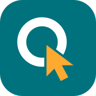
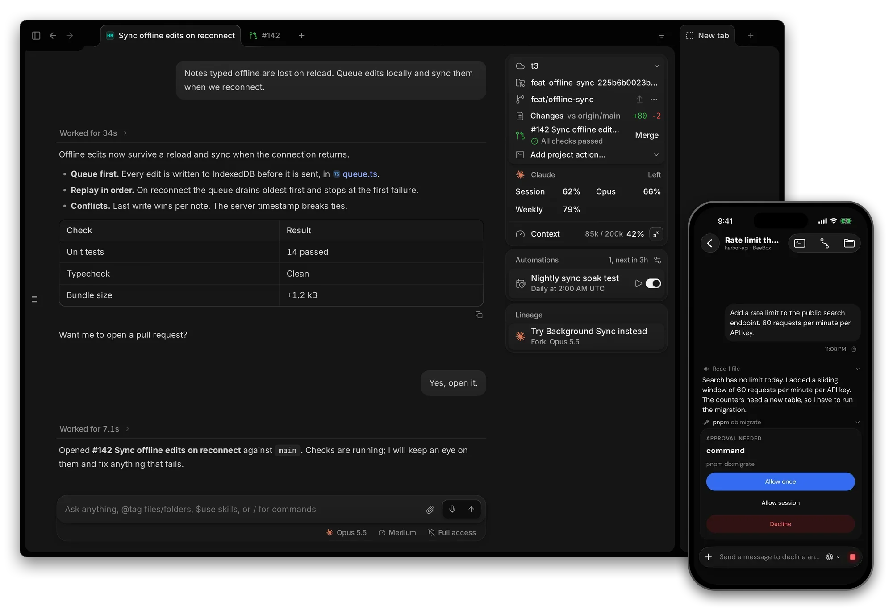

<p align="center">
  <a href="https://t3.codes">
    
  </a>
</p>

<h1 align="center">T3 Code</h1>

<p align="center">The open-source control plane for coding agents.</p>

<p align="center">
  <a href="https://github.com/ScriptedAlchemy/t3code/releases"><strong>Download</strong></a> ·
  <a href="./docs/README.md">Docs</a> ·
  <a href="https://discord.gg/jn4EGJjrvv">Discord</a>
</p>

<p align="center">
  <a href="https://t3.codes">
    
  </a>
</p>

This repository is the **ScriptedAlchemy fork** of [T3 Code](https://github.com/pingdotgg/t3code). The fork's [Nightly releases](https://github.com/ScriptedAlchemy/t3code/releases) include the desktop app and the standalone `t3` CLI with its bundled web app. Install these builds to use this fork's features. The upstream hosted web app, mobile store apps, npm package, and community packages are separate distributions; see [Upstream distributions](#upstream-distributions).

T3 Code runs the coding agents on your machine and gives them one fast interface. Start a thread at your desk, then approve the next step from your phone.

It works with Claude Code, Codex, Cursor, OpenCode, Grok Build, Antigravity, Kiro, Pi, Muse Code, fx, and any [ACP](./docs/user/providers-acp.md) agent. If an agent is set up on your computer, T3 Code can control it.

## What you get

- **Your subscriptions.** T3 Code does not resell tokens. It drives the agents you are already signed in to.
- **Every agent in one place.** Change models in the middle of a thread. Let Claude hand a task to Codex.
- **Desktop, web, and phone.** One server, and every client shows the same threads. There are apps for iOS and Android.
- **Remote ready.** Run agents on any machine. Connect over your local network, Tailscale, or [T3 Connect](./docs/user/remote-access.md).
- **Git built in.** Each thread can work in its own worktree. Review the diff, then commit, push, and open a pull request with one button.
- **Fast.** Performance is a feature here. We measure it, and we treat a dropped frame as a bug.
- **Open.** Source code is MIT licensed. If you don't like something, fork it under your own branding (see [Trademarks and forks](#trademarks-and-forks)).

## Install

### Desktop app

Install the desktop app for your platform from the fork's [GitHub Releases](https://github.com/ScriptedAlchemy/t3code/releases). Keep its update track on **Nightly**, which is the track this fork currently publishes.

On Debian or Ubuntu, download the fork's `.deb` from that release, then:

```bash
sudo apt install ./T3-Code-*.deb
```

### Command line

This installs the `t3` command. Run `t3` to start the server and open the web app.

```bash
curl -fsSL https://raw.githubusercontent.com/ScriptedAlchemy/t3code/main/scripts/install.sh | sh
```

On Windows, in PowerShell:

```powershell
irm https://raw.githubusercontent.com/ScriptedAlchemy/t3code/main/scripts/install.ps1 | iex
```

The installer defaults to this fork's Nightly channel. `t3 update` moves to a newer fork release.

This fork does not publish the `t3` npm package. `npx t3@latest` and `npx t3@nightly` run upstream builds.

### Phone

The store apps are upstream builds (see below). They connect to a fork server when their protocol version is compatible, but they do not show this fork's client screens; for those, build the mobile app from this repository. Then follow [remote access](./docs/user/remote-access.md) to connect it to your computer.

### Sign in to an agent

T3 Code needs one agent that is installed and signed in. For example, install [Claude Code](https://claude.com/product/claude-code) and run `claude auth login`, or install [Codex CLI](https://developers.openai.com/codex/cli) and run `codex login`.

[Provider setup](./docs/user/install.md#providers) has the steps for each agent. [Install T3 Code](./docs/user/install.md) covers nightly builds, AppImage, WSL, and NixOS.

### Upstream distributions

The [hosted web app](https://app.t3.codes), [iOS app](https://apps.apple.com/us/app/t3-code-remote-claude-more/id6787819824), [Android app](https://play.google.com/store/apps/details?id=com.t3tools.t3code), and the package-manager commands below distribute upstream T3 Code. They do not include this fork's client changes. Use the fork's desktop app or bundled web app for its UI; its native mobile changes require a mobile build from this repository.

| Platform   | Command                                                          |
| ---------- | ---------------------------------------------------------------- |
| macOS      | `brew install --cask t3-code`                                    |
| Windows    | `winget install T3Tools.T3Code` or `scoop install extras/t3code` |
| Arch Linux | `yay -S t3code-bin`                                              |
| Nix        | `nix profile add github:NixOS/nixpkgs/nixos-unstable#t3code`     |

## "Wait, what are you selling me?"

Nothing. We built T3 Code because we wanted the best possible development experience with agents. We were inspired by existing solutions like the Codex desktop app, Conductor, Claude Desktop and Cursor Glass, but none met our bar.

We wanted something performant, remote-ready, and truly open. If we ever go the wrong direction, we want you to have everything you need to fork the source code and build the tool that you want, under your own name and branding.

## Documentation

- [Install and first run](./docs/user/install.md)
- [Remote access from a phone or another machine](./docs/user/remote-access.md)
- [Permission modes](./docs/user/permission-modes.md)
- [Source control](./docs/user/source-control.md)
- [Connect outside agents over MCP](./docs/user/outside-agents.md)
- [FAQ](./docs/user/faq.md)

[All docs](./docs/README.md) has the full list.

## Contributing

We have limited review capacity. Small, focused fixes are the most likely to be merged. Features need an approved discussion first.

- Read [CONTRIBUTING.md](./CONTRIBUTING.md) before you report a bug or open a pull request.
- Put feature requests in [Ideas](https://github.com/pingdotgg/t3code/discussions/categories/ideas).
- Build from source with the [development runbook](./docs/operations/00_development.md#first-checkout). The [architecture overview](./docs/internals/01_architecture.md) explains how it works.
- Get help in [Discord](https://discord.gg/jn4EGJjrvv).

## License

The source code in this repository is licensed under the [MIT License](./LICENSE).

## Trademarks and forks

The MIT license applies **only to the source code**. It does not grant any rights to T3 Tools, Inc.'s trademarks, branding, or trade dress, including the **T3 Code** name, wordmark, logos, and application icons.

If you fork, redistribute, or build on T3 Code's source code:

- **Use your own branding.** Replace the T3 Code name, wordmark, logos, and application icons in any public fork, redistributed build, website, package, or app store listing.
- **Be explicitly clear that your project is unofficial.** Do not use the T3 Code name, wordmark, logo, or branding in your own projects without making it unmistakably clear that your project is unofficial and not affiliated with or endorsed by T3 Tools, Inc.

Using our name, wordmark, logo, or branding in a way that suggests official status or affiliation is trademark infringement and unlawful. **Any project indicating or implying that it is an official version of T3 Code when it is not will be pursued to the full extent of the law.**

See [TRADEMARK.md](./TRADEMARK.md) for the full trademark and branding policy.
