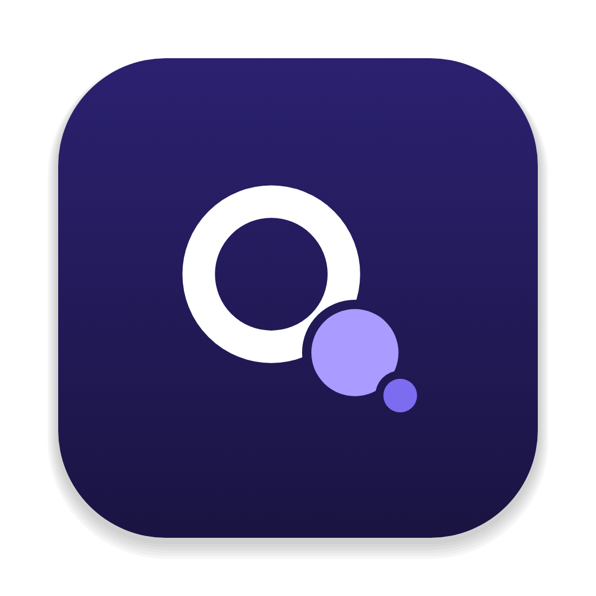

  

<h1 align="center">T3 Code (ryankhart's fork)</h1>

  
  

  <a href="https://github.com/ryankhart/t3code/releases/latest"><b>Download</b></a>
&ensp;•&ensp;
  <a href="./FORK.md">How this fork works</a>
&ensp;•&ensp;
  <a href="https://github.com/munimtechnologies/mtcode#readme">MT Code</a>
&ensp;•&ensp;
  <a href="https://github.com/pingdotgg/t3code#readme">T3 Code</a>

## What this is

A personal build of T3 Code, a desktop app for running coding agents (Claude Code, Codex, Cursor, OpenCode and others) from one place. It's three layers stacked on each other:

1. **[T3 Code](https://github.com/pingdotgg/t3code)**, the original app by Theo and the T3 team.
2. **[MT Code](https://github.com/munimtechnologies/mtcode)**, Munim Technologies' fork of T3 Code. It adds a lot on top (Computer Use, realtime voice, a plugin marketplace and more) and merges T3 Code regularly. Its README has [the full list of what MT Code adds](https://github.com/munimtechnologies/mtcode#mt-code-vs-t3-code).
3. **This fork**: the features and fixes below, kept as a short stack of commits on top of each MT Code release.

So you get everything T3 Code and MT Code do, plus the extras listed here. The app shows the name "T3 Code", but underneath it's MT Code's build, so it shares MT Code's settings folder (`~/.mt`) and an existing MT Code install upgrades in place.

This is a one-person fork built for my own use. It's public in case the features are useful to someone else, but there's no support promise.

## Download

Get the newest release from **[GitHub Releases](https://github.com/ryankhart/t3code/releases/latest)**:

- **Windows** (x64): `T3-Code-Fork-<version>-x64.exe`
- **Android**: `T3-Code-Fork-<version>.apk`, sideloaded. It installs as a separate app named "T3 Code Fork", next to the official T3 Code app, and pairs with the desktop app like the official one does.

There are no macOS or Linux builds. The Windows installer is unsigned: if SmartScreen warns, choose **More info → Run anyway**.

The desktop app updates itself from this repository's releases. Heads-up: an update installs and restarts the app by itself within about a minute of a release, which stops any agent runs in progress.

Because it uses MT Code's app identity and data folder, it replaces MT Code rather than installing beside it. Your MT Code threads, settings and projects carry over. It does install beside official T3 Code, which uses `~/.t3`.

## Before you start

The app drives agents you already have. Install and sign in to at least one provider CLI:

- Claude: install [Claude Code](https://claude.com/product/claude-code) and run `claude`
- Codex: install [Codex CLI](https://developers.openai.com/codex/cli) and run `codex login`
- Cursor: install [Cursor CLI](https://cursor.com/cli) and run `agent login`
- Grok Build: install [Grok Build CLI](https://x.ai/cli) and run `grok login`
- OpenCode: install [OpenCode](https://opencode.ai) and run `opencode auth login`
- Kiro, Pi, Muse Code, fx and Antigravity work too; see [MT Code's setup list](https://github.com/munimtechnologies/mtcode#before-you-start).

Your existing subscriptions are used directly. Nothing here sells anything, adds accounts, or sends your work anywhere except to the providers you use.

## What this fork adds

On top of everything in [MT Code](https://github.com/munimtechnologies/mtcode#mt-code-vs-t3-code).

### Desktop

| Feature                                      | What it does                                                                                                                                                                                                                                                                                                                                                                                                                                                                                                                       |
| -------------------------------------------- | ---------------------------------------------------------------------------------------------------------------------------------------------------------------------------------------------------------------------------------------------------------------------------------------------------------------------------------------------------------------------------------------------------------------------------------------------------------------------------------------------------------------------------------- |
| **Next-prompt buttons**                      | After a run, up to four buttons float above the message box with likely next messages, including skills and slash commands. A click adds it to your message (after a blank line if there's already text; a slash command goes first) and never sends; click again to take it back out, so you can pick several. Tab takes the first, Escape hides them. With the Labs "Suggest next prompt" switch on, the provider's own guess and a small model's picks show; replies with an `options` block show their own buttons either way. |
| **`options` blocks become buttons**          | An agent can end its reply with a fenced code block whose language is `options`, one next message per line. The app hides the block and shows the lines as next-prompt buttons, instead of a multiple-choice pop-up that covers half the window.                                                                                                                                                                                                                                                                                   |
| **Read replies aloud**                       | A speaker button beside Copy reads the final reply using Microsoft Edge's natural voices. Code blocks are read as "Code block" and file paths as file names. Pick the voice in Settings → General → Read aloud. Needs the [`edge-tts`](https://github.com/rany2/edge-tts) command (`uv tool install edge-tts`); without it, the basic Windows voice is used.                                                                                                                                                                       |
| **Settle a thread that's asking a question** | Settling used to fail while the agent waited on a multiple-choice question. Now Settle dismisses the question, stops that run and settles, from any entry point (sidebar, header, shortcut, phone). Approvals still block Settle.                                                                                                                                                                                                                                                                                                  |
| **Inline pages can fill the message box**    | A page an agent shows in the chat (`html_render`) can add text to that thread's message box when you click one of its buttons, for example "Send my picks". It only adds text; you still press Send.                                                                                                                                                                                                                                                                                                                               |
| **Move a No project thread into a project**  | A thread started without a project can be filed under an existing project from its menu.                                                                                                                                                                                                                                                                                                                                                                                                                                           |
| **New thread button setting**                | Settings → General → Sidebar → New thread button: "No project" makes New thread start a scratch thread straight away instead of opening the project picker. Shift+click still starts in the current project.                                                                                                                                                                                                                                                                                                                       |
| **Search Google for selected text**          | Right-click selected text and choose **Search Google for "…"** to look it up in your default browser.                                                                                                                                                                                                                                                                                                                                                                                                                              |
| **Markdown frontmatter as a table**          | The `---` properties block at the top of a Markdown file shows as a neat table instead of raw text.                                                                                                                                                                                                                                                                                                                                                                                                                                |
| **Step counts on folded turns**              | A collapsed run shows how many steps it took.                                                                                                                                                                                                                                                                                                                                                                                                                                                                                      |
| **Titles shimmer while they regenerate**     | A thread title being rewritten shows a shimmer, so you can tell it's about to change.                                                                                                                                                                                                                                                                                                                                                                                                                                              |

### Phone (Android)

The same features ported to the Android app: next-prompt buttons (tap to add, tap again to remove), `options` blocks as buttons, inline pages filling the message box, moving a No project thread into a project, the New thread button setting, step counts, shimmering titles, frontmatter tables, and read aloud. Plus these phone-only additions:

| Feature                    | What it does                                                                                                                                                                                                                             |
| -------------------------- | ---------------------------------------------------------------------------------------------------------------------------------------------------------------------------------------------------------------------------------------- |
| **Settle from the thread** | A checkmark in the open thread's header settles it and goes back to the list, with Undo for 10 seconds. On a settled thread the checkmark un-settles it. The header's Files, Git and Terminal buttons fold into one ⋮ menu to make room. |
| **Back to where you were** | Going back from a thread scrolls the list to that thread and highlights it once.                                                                                                                                                         |

Read aloud on the phone uses a small speech service on the paired PC (port 3776 over Tailscale), because the phone's own voices are poor. It works over a direct Tailscale connection, not a relay. Details in [FORK.md](./FORK.md#phone-app).

### Fixes

- **Phone app no longer crashes after pairing.** MT Code's computer-task code needs `crypto.getRandomValues`, which the phone's JavaScript engine lacks; this build supplies it.
- **Settling a waiting question can't send the agent a blank answer.** Stop withdraws the question properly instead of answering it empty.

## How it stays up to date

Every four hours a GitHub Actions pipeline checks for a new MT Code release. When there is one, it re-applies this fork's commits on top, runs the tests for the files those commits touch, builds the Windows installer and the Android APK, checks each fork feature is inside the installer, and only then publishes a release. If anything fails, nothing is published and installed copies stay as they are. When MT Code or T3 Code ships its own version of a fork feature, the fork's copy is dropped.

The full explanation, including branches and version numbers, is in [FORK.md](./FORK.md).

## Documentation

- What MT Code adds over T3 Code, and its docs list: [MT Code's README](https://github.com/munimtechnologies/mtcode#readme)
- T3 Code itself: [T3 Code's README](https://github.com/pingdotgg/t3code#readme) and [docs](https://github.com/pingdotgg/t3code/tree/main/docs)
- User guides shipped with this build: [docs/user](./docs/user) (remote access, keyboard shortcuts, permission modes, and more)
- How this fork is built and released: [FORK.md](./FORK.md)
- Building from source: start at [docs/internals/overview.md](./docs/internals/overview.md)

## Reporting problems

Problems with a feature listed above belong in [this repository's issues](https://github.com/ryankhart/t3code/issues). Please don't report this fork's problems to [MT Code](https://github.com/munimtechnologies/mtcode/issues) or [T3 Code](https://github.com/pingdotgg/t3code/issues); check first that the problem also happens in their own builds.

## Credits

All the hard work is [T3 Code](https://github.com/pingdotgg/t3code)'s and [MT Code](https://github.com/munimtechnologies/mtcode)'s. This fork exists because both are truly open. Licensed like MT Code: [Apache 2.0](./LICENSE), with T3 Code's parts under [MIT](./LICENSE-MIT); see [NOTICE](./NOTICE).
