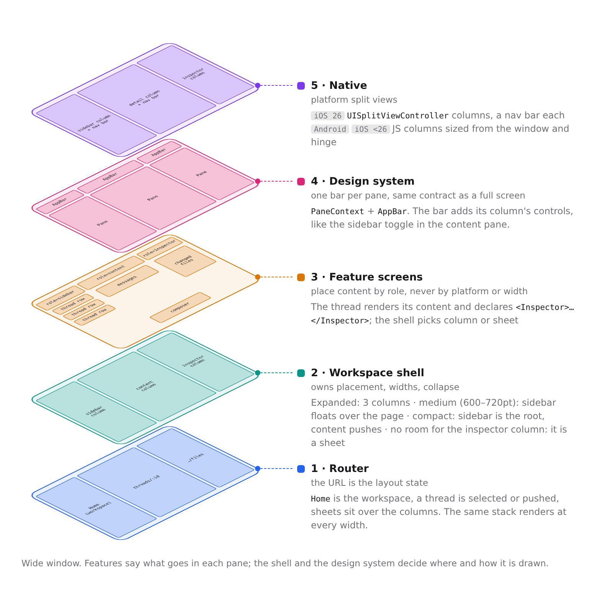
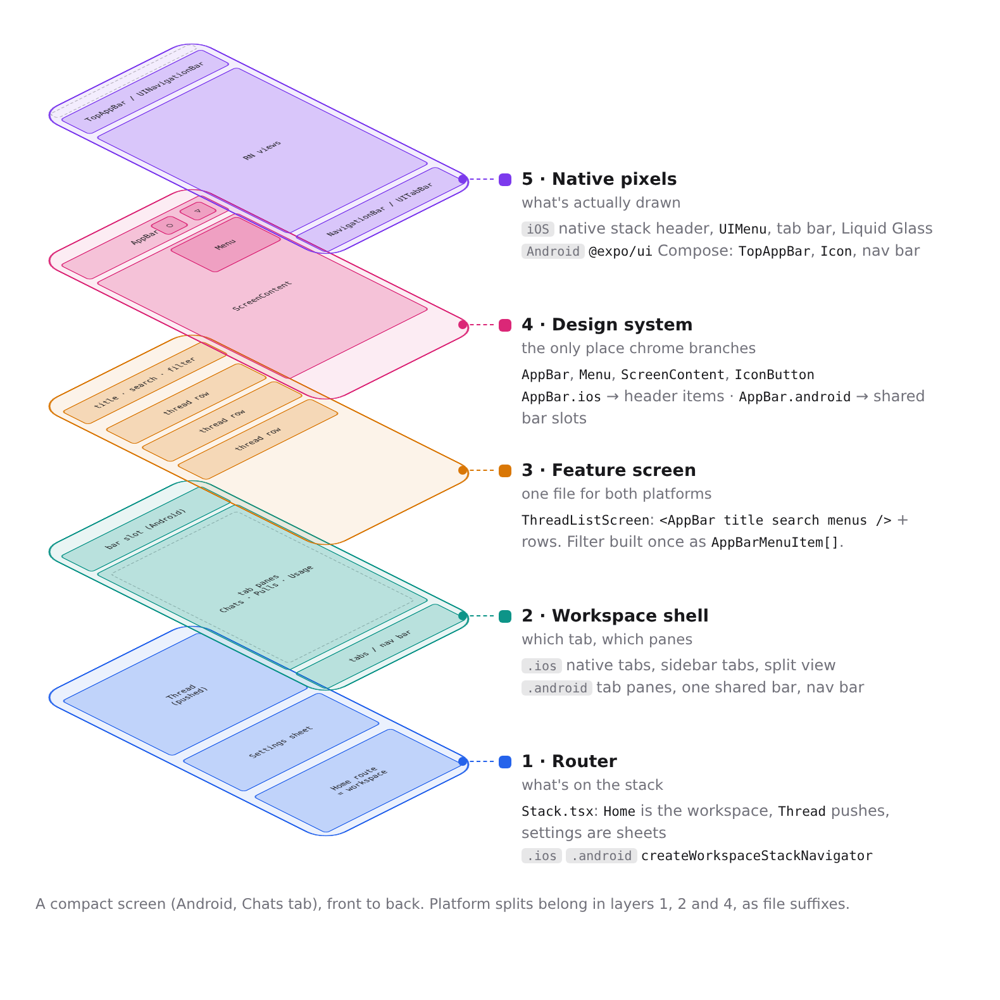

# Mobile layout

The mobile app runs on phones, foldables, tablets and resizable iPad windows. One rule keeps
that manageable: each layer below makes one decision, and no layer makes another's. A feature
screen never asks which platform or window width it is on.

## The layers

1. **Router.** The [root stack](../../apps/mobile/src/Stack.tsx) is the layout state: what is
   selected, what is pushed, which sheet is open. Rotating, folding or resizing renders the same
   stack differently. Nothing remembers which column a page was in. See
   [Mobile navigation](./mobile-navigation.md).
2. **Workspace shell.** The [adaptive layout](../../apps/mobile/src/features/layout/AdaptiveWorkspaceLayout.tsx)
   owns placement and widths, from the width class in [`layout.ts`](../../apps/mobile/src/lib/layout.ts):
   - _Expanded_: sidebar, content and inspector columns.
   - _Medium_ (600–720pt wide): the sidebar sits beside a list and floats over a page.
   - _Compact_ (under 600pt either way): the sidebar is the root, and pages push.
   - Where the inspector column does not fit, the inspector is a sheet.
3. **Feature screens.** A screen places content by role. It renders its page and declares side
   content with `<Inspector>`, and asks for it with `showInspector()`. The shell decides
   between column and sheet. Choosing a route or a component by width or platform here is the bug
   this structure exists to prevent.
4. **Design system.** Every pane has an `AppBar` with the same contract as a full screen.
   [`PaneContext`](../../apps/mobile/src/components/ui/Pane.tsx) tells the bar which column it is
   in, so it adds that column's controls, such as the sidebar toggle. Chrome branches by platform
   only here.
5. **Native.** On iOS 26, the columns are `UISplitViewController` columns with a navigation bar
   each. On Android and on iPadOS 18–25, the shell draws the same columns in JS from the window
   and hinge metrics.

Platform splits live in layers 1, 2 and 4, as `.ios` and `.android` files.

## Traps

- iPadOS 18–25 runs the JS columns, and the iOS deployment target is 18. Code that looks
  Android-only in the JS column path is still live on those iPads.
- Android renders `Home` twice: in the sidebar column and as the root of the content stack. The
  sidebar copy is never the focused route, so hooks that gate on focus (such as Back handling)
  must also accept `usePaneRole() === "sidebar"`.
- Modals and full-screen pages are presented over the columns and render with no pane role, so
  they get no column chrome.
- A route opened from the inspector sheet must wait for the sheet to close, through
  `InspectorSheetContext`. Presenting over a closing sheet races its dismissal on iOS.
