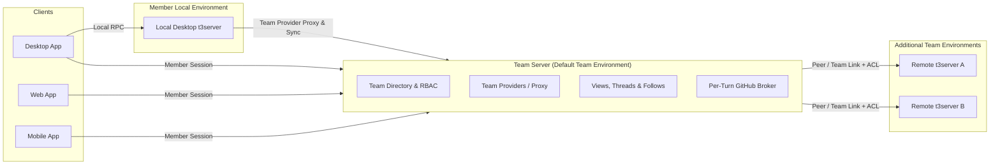

# Teams Architecture & Technical Specification

This document specifies how team features integrate into T3 Code's existing architecture (`apps/server`, `packages/contracts`, `packages/client-runtime`, `apps/web`, `apps/desktop`, and `apps/mobile`).

It builds directly on T3 Code's core invariants:

- Execution stays in the environment that owns the workspace ([01_architecture.md](../internals/01_architecture.md)).
- Every RPC and subscription is server-authorized ([04_environment-auth.md](../internals/04_environment-auth.md)).
- Orchestration mutations flow through event-sourced commands, projections, and outbox effects (`apps/server/src/orchestration-v2`).
- Shared client state and connection management live in `packages/client-runtime` ([09_connection-runtime.md](../internals/09_connection-runtime.md)).

---

## 1. Topology & Ownership Model



### Key ownership rules

1. **One Team Server is the source of truth.** A Team is defined in client settings by linking to a remote `t3server`. That server owns:
   - Team metadata, members, pseudos, and roles.
   - Invite links (deep links) and member sessions.
   - Views (visibility + posting rules).
   - Team-scoped provider configurations.
   - The registry of additional remote environments linked to the team and their per-environment ACLs.
   - Team project assignments, thread ownership (`creatorMemberId`), thread `viewId`, lock state, and per-member follow subscriptions.
2. **Default team environment.** The Team Server itself is automatically the team's default execution environment.
3. **Additional remote environments.** Team owners/admins can register other remote `t3server` instances on the Team Server (building on T3 Code's existing peer-link / remote-environment model in `apps/server/src/peer`).
4. **Local + remote thread placement.** When starting a new thread on a project assigned to a team, the user can choose:
   - Their **local environment** (the desktop app's bundled server), or
   - Any **remote environment** attached to the team (including the default team environment) that the user's role/whitelist permits them to access.

---

## 2. Identity, Joining, and Pseudos

### Member model

Upstream T3 Code's `SessionStore` binds sessions to scopes (`AuthEnvironmentScope`), not to named human users. For teams, we extend authentication with a first-class **Member principal**:

- `memberId`: immutable UUID/ULID generated on the Team Server. All ownership, ACL whitelists, follows, and audit trails reference `memberId`—never the mutable display pseudo.
- `pseudo`: unique-per-team handle (normalized/trimmed, e.g., `^[a-zA-Z0-9._-]{2,32}$`). Used in UI thread prefixes (`pseudo: <title>`), member pickers, and whitelists.
- `role`: `"owner" | "admin" | "modo" | "regular"`.
- `status`: `"active" | "suspended" | "removed"`.
- Every `SessionStore` row created via a team invite or member login carries `memberId`. The server resolves the acting member exclusively from the authenticated session—client payloads cannot spoof `memberId` or `pseudo`.

### Joining a team

Two supported flows:

1. **Deep-link invite (primary):**
   - An `owner`, `admin`, or `modo` (up to their own role) generates a one-time or bounded-use invite link on the Team Server, optionally prefilling `pseudo` and setting the granted `role`.
   - Format: `t3code://team/join?server=<encoded-url>&token=<invite-token>&pseudo=<optional-pseudo>` (and a hosted-web equivalent using URL fragment `#token=...` so the secret never hits a hosted origin, matching [05_remote.md](../internals/05_remote.md#hosted-web-is-a-client)).
   - Opening the link in the desktop/web/mobile app opens a Join Team modal with the server URL and prefilled `pseudo` (editable if not locked by invite). Confirming exchanges the invite token for a member-bound DPoP/bearer session.
2. **Manual setup in Settings:**
   - In **Settings → Teams → Add Team**, the user enters the Team Server URL, invite token / pairing credential, and chooses their `pseudo`.
   - The server validates pseudo uniqueness and creates/binds the member session.

### Auto-attribution

- **Thread creation:** Every thread created on a team project automatically stamps `creatorMemberId = session.memberId` in the orchestration event (`thread.created`) and projection.
- **Turns / prompts:** Every user message / turn command stamps `authorMemberId = session.memberId`.
- **UI rendering:** Team threads are prefixed dynamically as `${creatorPseudo}: ${title}`. Storing `creatorMemberId` separately from `title` avoids double-prefixing and keeps titles accurate if a member later changes their pseudo.

---

## 3. Roles, Permissions, Views, and Locking

### Role hierarchy

```text
owner (4) > admin (3) > modo (2) > regular (1)
```

#### Role assignment rules

- Member invitation and role management start at `modo` (`regular` members cannot invite users or change roles).
- A member with role $R \ge \text{modo}$ may assign any role $R' \le R$ to another member.
- **Safety guardrails:**
  - A member cannot modify or demote a member whose current role is strictly higher than their own ($R_{\text{target}} > R_{\text{actor}}$).
  - The team must always retain at least one active `owner` (the server rejects demoting or removing the last `owner`).
  - Invite links follow the same ceiling: a member with role $R \ge \text{modo}$ can only mint invites with role $\le R$.

#### Capability matrix

| Action                                         | `regular` | `modo`            | `admin`                    | `owner`   |
| ---------------------------------------------- | --------- | ----------------- | -------------------------- | --------- |
| Join team, manage own pseudo & GitHub token    | Yes       | Yes               | Yes                        | Yes       |
| Invite members / assign role $\le$ own role    | No        | `regular`, `modo` | `regular`, `modo`, `admin` | All roles |
| Create / edit / delete Views                   | No        | No                | Yes                        | Yes       |
| Change a thread's View                         | No        | Yes               | Yes                        | Yes       |
| Create locked thread / lock & unlock threads   | No        | No                | Yes                        | Yes       |
| Steer another user's ongoing turn              | No        | No                | Yes*                       | Yes*      |
| Configure team providers & remote environments | No        | No                | Yes                        | Yes       |
| Configure per-environment ACLs                 | No        | No                | Yes                        | Yes       |
| Delete team / transfer last owner              | No        | No                | No                         | Yes       |

_\*See [Section 6](#6-per-turn-github-identity-forwarding--turn-isolation) for the exact security handling when an `owner`/`admin` intervenes in another user's ongoing turn._

### Views (server-enforced read & post policies)

> **Important distinction:** Upstream `packages/client-runtime/src/savedViews.ts` implements _client-side saved filter views_. Team **Views** are a distinct, **server-enforced authorization concept**—we should name them clearly in code (e.g., `TeamView` / `teamViewId`) to avoid confusion.

Every team has at least one built-in **Default View** (`isDefault: true`, cannot be deleted):

- **Default View read policy:** All team members can see threads in the Default View.
- **Default View post policy:** All team members can post in each other's threads in the Default View by default (`owner`/`admin` can tighten this later if desired).

Each `TeamView` defines two independent access policies:

```ts
interface AccessRule {
  /** Minimum role or explicit set of roles allowed. */
  roles: ReadonlyArray<TeamRole>;
  /** Explicit memberIds granted access regardless of role. */
  memberIds: ReadonlyArray<MemberId>;
}

interface TeamView {
  id: TeamViewId;
  teamId: TeamId;
  name: string;
  description?: string;
  isDefault: boolean;
  /** Who can see threads in this view (and create new threads in it). */
  readRule: AccessRule;
  /** Who can post in OTHER members' threads in this view. */
  postRule: AccessRule;
}
```

#### Authorization evaluation rules (enforced server-side)

1. **Read access (`canReadThread`):**
   - `owner` and `admin` can always read all views/threads (or opt-in, at minimum `owner` always has full visibility so nothing is orphaned).
   - Otherwise, member matches `view.readRule` (`roles.includes(member.role) || memberIds.includes(member.id)`).
   - **Critical:** Enforcement happens on the server in `subscribeShell`, `subscribeThread`, `searchThreads`, `getThreadProjection`, `getTurnDiff`, `getThreadTitles`, and asset/artifact endpoints—never just hidden in the UI.
2. **Thread creation (`canCreateThreadInView`):**
   - Any member who satisfies `view.readRule` can create a thread in that view.
   - Creating a **locked** thread requires `owner` or `admin`.
3. **Posting in a thread (`canPostInThread`):**
   - First, the member must satisfy `canReadThread`.
   - If `thread.locked === true`: **only `owner` and `admin`** can post (even if the member is the thread creator).
   - If `thread.locked === false`:
     - The thread creator (`thread.creatorMemberId === member.id`) can post in their own thread.
     - Any other member must satisfy `view.postRule`.
   - Viewing a thread never implies posting rights; the UI disables/hides the composer with a clear read-only indicator when `canPostInThread` is false, and the server rejects `dispatchCommand` with an authorization error.
4. **Changing a thread's View (`canChangeThreadView`):**
   - Allowed for `owner`, `admin`, and `modo` (provided they have access to the target view).
   - Moving a thread to a narrower view immediately updates live shell/thread subscriptions so unauthorized connected clients drop the thread from their state.
5. **Locking / unlocking (`canToggleThreadLock`):**
   - Allowed for `owner` and `admin`. Emits an orchestration event so all connected clients update immediately.

---

## 4. Team Projects, Environments, and Team Providers

### Assigning a project to a team

- Project creation (and project settings) gains an optional `teamId` selector (default: personal / no team).
- A team-assigned project stores `{ teamId, defaultViewId? }` in its project metadata on the Team Server and links clones across environments using T3 Code's existing repository identity correlation ([05_remote.md](../internals/05_remote.md#identity-is-independent-of-the-route)).

### Local vs. remote execution & thread syncing

- When a member starts a thread on a team-assigned project using their **local environment**, **the thread is synced into the Team Server's team thread list** (with its `creatorMemberId`, `viewId`, and mirrored transcript/status updates) so colleagues with access to that View can see it alongside remote threads.
- The key difference between starting a thread on a **local environment** vs. a **remote team environment** is **where tool calls and agent execution run** (e.g., testing changes locally on a developer's laptop vs. running on a shared remote server).
- **Absolute local-execution boundary:**
  - The local desktop server pushes thread metadata and transcript updates to the Team Server so the thread stays visible in the team thread list even when the developer's laptop goes offline (colleagues see the synced history in read-only mode while offline).
  - Tool calls on a local-environment thread execute **exclusively** on the owner's local machine. **No other team member—not even `owner` or `admin`—can execute turns or tool calls on another member's local environment.**

### Inaccessible environments, Thread Notes & Anti-Prompt-Injection Flow

Whenever a member can read a team thread (via its View) **but cannot execute turns on its attached environment**—either because it runs on another member's **local environment** (blocked for everyone else, including `owner`/`admin`) or because it runs on a **remote team environment restricted by ACL**—the thread remains fully readable, with a unified safe collaboration UX:

#### Colleague UX (no execution access)

- The standard prompt composer is **disabled/greyed out**, with a highlighted localized (`team.*`) banner directly above it:
  > _You cannot prompt this thread because it is attached to an environment you do not have access to (**\<environment label, e.g., Jean's local environment\>**). You can fork it or leave a note._
  >
  > `[ Fork this thread ]` `[ Leave a note ]`
- **Fork this thread:** Opens a quick picker of environments the colleague _does_ have access to (their own local environment or an accessible team environment) and creates a new thread owned by them via T3 Code's portable context handoff, linked back to the source thread.
- **Leave a note** _(available when the thread is unlocked for the actor and the View grants `postRule`)_:
  - Switches the composer **in place** into Note Mode (no blocking modal) with a distinct visual accent and `Send note` / `Cancel` controls.
  - Appears inline in the thread timeline at its chronological position as a distinct card labeled **`Note from <pseudo>:`** with a `Pending` status pill, and notifies the thread owner (Milestone 2).

#### Security model (anti-prompt-injection & race-condition proof)

1. **Author immutability + `contentHash` (no bait-and-switch):**
   - A note's `body` is **immutable** for its author after creation (the author may only delete a `pending` note, never edit it).
   - The server computes `original_content_hash` (SHA-256) at creation so an author can never swap benign text for a prompt injection while the owner is approving it.
2. **Owner edit-before-use:**
   - The thread owner / environment executor (e.g., Jean) **can edit a pending note** if they want to adjust part of it before sending it to the agent.
   - The edit is stored separately (`edited_body`, `edited_content_hash`) while preserving `original_body` for audit transparency (displayed as `Note from Paul (edited by Jean):`).
3. **Role-based confirmation friction (`regular` vs. `modo`+):**
   - **Author is `regular`:** Because newly onboarded / `regular` members carry higher prompt-injection risk, **accepting the note or applying an edit requires an explicit UI confirmation dialog** displaying the exact full text that will be passed to the agent on the owner's environment.
   - **Author is `modo`, `admin`, or `owner`:** Trusted roles skip the extra confirmation modal—accepting, editing, or using the 1-click **Accept & Send** action executes immediately.
4. **Zero implicit model injection:**
   - The orchestrator **never** pulls `pending` or `rejected` notes into the LLM prompt.
   - Every turn dispatch explicitly passes `acceptedNotes: Array<{ noteId, contentHash }>` (matching `edited_content_hash ?? original_content_hash`), verified server-side / by the executor before building the model prompt.
   - Accepted notes are clearly attributed in the prompt (`[Note from Paul (approved by Jean)]: ...`) and permanently bound to `included_in_turn_id`.
   - Rejected notes remain visible in chronological order (muted/collapsed with a `Rejected` pill) and are never sent to the model.
5. **Empty prompt allowed with accepted note(s):**
   - When at least one note is `accepted` (and not yet consumed by a turn), the owner may submit an **empty prompt** (`""`) so a colleague's suggested prompt can be executed directly without adding redundant text.
6. **Concurrent-arrival race condition (TOCTOU protection):**
   - If Paul posts a note `N` milliseconds before Jean hits Send (so `N` is not in Jean's `acceptedNotes` payload):
     - Jean's turn is **not** blocked with an error and **must ignore `N`** completely.
     - The server atomically **re-anchors `N` after the new turn** (`anchor_turn_id = newTurnId`) so `N` appears chronologically _after_ Jean's turn in the history, still `pending` for Jean's next turn.
   - Notes arriving while a turn is already running similarly anchor after the active turn (`anchor_turn_id = activeTurnId`) and never steer the active turn.

#### Owner UX (fluid, minimal friction)

- Pending note cards show inline actions directly in the timeline: **`Accept`**, **`Edit`**, **`Reject`**, plus a 1-click **`Accept & Send`** shortcut when the owner's composer is empty (subject to the confirmation dialog if the author is `regular`).
- If the owner types a prompt while visible pending notes remain undecided, a compact 1-line bar appears above the composer (`1 pending note from Paul — decide before sending`) and disables Send until visible pending notes are resolved. Until Send is clicked, accepted/rejected states remain toggleable.

### Team Environments & per-environment ACLs

- The Team Server maintains a `team_environments` table:
  - Entry 0: the Team Server itself (`isDefault: true`).
  - Additional entries: remote `t3server` instances attached by `owner`/`admin`.
- Each environment has an `accessRule: AccessRule`:
  - **Default:** all roles (`["owner", "admin", "modo", "regular"]`) — everyone on the team can access it.
  - **Restricted:** `owner`/`admin` can restrict an environment to specific roles and/or whitelisted `memberIds` (e.g., production/staging box restricted to `admin` + two senior devs).
- **Enforcement:**
  - The client only displays environments the current member can access in the "New Thread → Environment" picker.
  - Launching a thread on a remote team environment goes through the Team Server's authorization check (or validates a short-lived team-signed environment grant) before the target environment starts the thread.

### Team Providers across all environments

Requirement: _Settings allow configuring model providers per team, and all threads on a team-assigned project use the team's configured providers regardless of which environment (local or remote) the thread runs on._

This is one of the trickiest architectural pieces because in upstream T3 Code, providers are local to each environment. We should solve it cleanly by separating **Provider Configuration** from **Credential Execution**:

1. **Team Provider Catalog (stored on the Team Server):**
   - `owner`/`admin` configure team provider instances in **Settings → Teams → \<Team\> → Providers** (model allowlists, default models, provider instances, API keys / endpoints).
2. **How threads on _any_ environment use Team Providers:**
   - **API-backed providers (Anthropic, OpenAI, OpenRouter, custom OpenAI/Anthropic-compatible gateways, etc.):**
     - The Team Server exposes an authenticated **Team Model Proxy** (`/api/team/provider-proxy/:providerInstanceId/...`).
     - Any execution environment (the Team Server itself, an attached remote environment, or a member's **local** desktop environment) receives the team's provider catalog and routes inference requests through the Team Server's proxy using the member's session token.
     - **Benefits:** Team API keys never leave the Team Server, revoking a member immediately cuts off model access on their local machine, and team usage/cost accounting is centralized.
   - **CLI / OAuth subscription providers (Claude Code, Codex CLI, Cursor, Antigravity, etc.):**
     - On the **Team Server** and **attached remote environments**, team-managed provider instances run directly with the environment's configured auth (or brokered tokens via a pattern like `CodexManagedTokenBroker.ts`).
     - On a **local environment**, if a provider supports API-base-URL override (e.g., Claude Code with `ANTHROPIC_BASE_URL` or Codex with custom base URL), it can route through the Team Model Proxy seamlessly. For CLI providers that require a native local subscription login and cannot be proxied, the UI should transparently indicate "Remote team environments only" rather than silently falling back to personal credentials.
3. **Invariant:** A thread on a team project must **never** silently fall back to the user's personal provider credentials without explicit indication.

---

## 5. UI, Filtering, and Notifications

Following `AGENTS.md` ("Hit every surface"), every user-facing team feature must cover sidebar/chat, Settings, command palette, keybindings, and web/desktop/mobile clients via `packages/client-runtime`.

### Thread list & filtering

- **Pseudo prefix:** Every team thread renders as `pseudo: <title>` (with subtle visual distinction for the pseudo badge/prefix so titles stay scannable).
- **Default filter:** In team projects, the sidebar defaults to **"My threads"** (threads where `creatorMemberId === currentMemberId`, plus optionally threads the user follows).
- **Show/Hide colleagues' threads toggle:** A prominent, persistent toggle in the sidebar header / project filter bar (plus command palette action & keyboard shortcut) switches between:
  - **My threads only** (default)
  - **All team threads** (all threads visible to the user across their accessible Views)
  - Optional secondary filters: by **View** and by **Member pseudo**.
- **Thread metadata badges:** Show the thread's current **View** pill (clickable by `modo`/`admin`/`owner` to change view) and a **Lock** icon (clickable by `admin`/`owner` to lock/unlock).

### Notifications & Following

- **Default rule:** A member receives desktop/web/mobile notifications for a team thread **only if**:
  1. They are the thread's creator (`creatorMemberId === currentMemberId`), **OR**
  2. They have explicitly **followed** the thread (`thread_follows` contains `(threadId, currentMemberId)`), **OR**
  3. _(Recommended ergonomic default)_ They posted the currently finishing turn in a colleague's thread (so you still get notified when _your_ prompt finishes, without subscribing to all future turns unless you follow).
- **Follow / Unfollow UI:**
  - Toggle button (bell icon) in the thread header, thread sidebar context menu, and command palette for any colleague's thread.
  - Stored server-side in `thread_follows` so follow state stays synced across desktop, web, and mobile push notifications.
- **Implementation hook:** Filter notification emission both server-side (for mobile push & server notification mailboxes in `apps/server/src/orchestration-v2/NotificationMailbox.ts`) and client-side (`apps/web/src/threadNotifications.ts`).

---

## 6. Per-Turn GitHub Identity Forwarding & Turn Isolation

### The problem to solve

In a shared environment, a single OS user runs the `t3server` and agent processes. Previously, all git/GitHub operations used one shared account (`msl-agent`) with manual commit co-signing. We want:

1. Every turn initiated by User A executes git/GitHub operations as **User A**.
2. If User B later posts a turn in the same thread, that turn executes git/GitHub operations as **User B**—never User A.
3. No other user can hijack an active turn's credentials via mid-turn steering.

### Credential storage & acquisition

- **Phase 1 (initial implementation):** Per-user **encrypted fine-grained PAT** configured in Settings. This requires zero OAuth App / GitHub App registration for self-hosted teams and unlocks per-user attribution immediately.
- **Phase 2 (follow-up):** **GitHub OAuth / GitHub App user-to-server tokens** for automatic short-lived token refresh and one-click sign-in.
- Tokens are encrypted at rest in the Team Server's `ServerSecretStore`, keyed by `memberId`, and never exposed to any other member or read model.
- When a member initiates a turn on an **attached remote environment** (not the Team Server itself), the Team Server mints a **single-turn, short-lived, scoped credential lease** for that remote environment, valid only for the duration of that `turnId`.

### Per-turn injection without credential leakage

A critical subtlety in T3 Code: provider processes (Claude Code, Codex, etc.) often persist across multiple turns as a warm `Session`. Setting `GH_TOKEN=<userA>` on process startup would **leak User A's token into User B's turn**.

To prevent this, we combine **two layers of defense**:

1. **Dynamic Turn-Scoped Credential Broker (primary):**
   - The server exposes a local-only Unix socket or loopback broker endpoint authenticated with a per-session secret.
   - Provider child processes receive:
     - `GIT_ASKPASS=/path/to/t3-git-askpass` (a tiny helper that asks the server broker for the credential bound to the thread's _currently active turn_).
     - `GH_TOKEN` is **not** set as a static long-lived secret; instead, `gh` is configured via a wrapper / `GH_CONFIG_DIR` or credential helper backed by the same turn-scoped broker (or a turn-scoped ephemeral file rotated/deleted on turn start/end).
     - `GIT_AUTHOR_NAME`, `GIT_AUTHOR_EMAIL`, `GIT_COMMITTER_NAME`, `GIT_COMMITTER_EMAIL` set from the active turn author's GitHub profile (via per-turn git config / wrapper so `git commit` attributes commits natively to the real user—no more `msl-agent`!).
   - When no turn is active (or after the turn settles/cancels), the broker immediately returns **no credential**.
2. **Session recycling on author switch (belt-and-suspenders):**
   - If Turn $N$ in a thread is initiated by `memberId = B` and the warm provider session was last run by `memberId = A` ($A \neq B$), the orchestrator **stops the warm provider process and resumes the session in a fresh process** before starting Turn $N$.
   - This eliminates any risk of in-memory token caching, lingering background subshells, or environment variable leakage from User A's turn into User B's turn.
   - T3 Code's `Session` model already supports stopping and resuming a provider session without losing thread history ([00_glossary.md](../internals/00_glossary.md)).

### Mid-turn steering isolation

- While a turn initiated by User A is running:
  - **Other `regular` and `modo` users cannot steer** the ongoing turn. The UI disables steering and only allows queueing a _new_ turn (if they have post permission), which will run after Turn A finishes—triggering the author-switch session recycle and using User B's GitHub identity.
  - **`owner` and `admin` users** are permitted to intervene:
    - To preserve strict GitHub credential isolation even when an `owner`/`admin` intervenes, we should offer (and default to) **Interrupt & Start New Turn** (which immediately revokes User A's active turn lease and runs the admin's follow-up under the admin's own identity), and if true mid-turn steering is used by an `owner`/`admin`, immediately **revoke/freeze the original user's GitHub credential lease** for the remainder of that turn so an admin cannot push/act on GitHub using User A's token.

### Residual threat model note (shared OS user)

- Because T3 Code's security boundary is the OS user running the environment ([04_environment-auth.md](../internals/04_environment-auth.md#the-environment-is-the-filesystem-boundary)), agents with shell access in the same OS user share the filesystem/worktree. Per-turn brokering + session recycling prevents accidental cross-user credential leakage and unauthorized steering, while true adversarial multi-tenant isolation would require per-user OS sandboxes/containers (out of scope for initial milestones, noted as a future hardening option).

---

## 7. Data Model Sketch (Team Server SQLite)

To avoid SQLite migration number collisions and `ALTER TABLE` conflicts with upstream `pingdotgg/t3code`, **all team tables live under a `team_*` prefix and are managed by an independent migration table (`team_schema_migrations` in `apps/server/src/team/migrations.ts`)** rather than modifying upstream's migration sequence or altering upstream tables.

### Core team tables

- `team_workspaces` (`id`, `name`, `default_view_id`, `created_at`, `updated_at`)
- `team_members` (`id`, `team_id`, `pseudo`, `role`, `status`, `github_login`, `github_name`, `github_email`, `created_at`, `updated_at`)
- `team_invites` (`id`, `team_id`, `token_hash`, `role`, `prefilled_pseudo`, `max_uses`, `uses`, `expires_at`, `created_by_member_id`, `revoked_at`)
- `team_views` (`id`, `team_id`, `name`, `is_default`, `read_roles_json`, `read_member_ids_json`, `post_roles_json`, `post_member_ids_json`, `created_at`, `updated_at`)
- `team_environments` (`id`, `team_id`, `environment_id`, `name`, `is_default`, `peer_link_id`, `access_roles_json`, `access_member_ids_json`, `created_at`, `updated_at`)
- `team_providers` (`id`, `team_id`, `provider_instance_id`, `config_json`, `proxy_enabled`, `created_at`, `updated_at`)
- `team_thread_follows` (`thread_id`, `member_id`, `created_at`)
- `team_thread_notes` (`id`, `thread_id`, `team_id`, `author_member_id`, `original_body`, `original_content_hash`, `edited_body`, `edited_content_hash`, `status`, `anchor_turn_id`, `anchor_seq`, `included_in_turn_id`, `resolved_by_member_id`, `resolved_at`, `created_at`)

### Sidecar metadata tables (no `ALTER TABLE` on upstream tables)

Instead of adding columns to upstream `sessions`, `projects`, `threads`, or `turns` tables, team metadata is stored in 1-to-1 sidecar tables keyed by upstream IDs:

- `team_session_meta` (`session_id PRIMARY KEY`, `team_id`, `member_id`)
- `team_project_meta` (`project_id PRIMARY KEY`, `team_id`, `default_view_id`)
- `team_thread_meta` (`thread_id PRIMARY KEY`, `team_id`, `creator_member_id`, `view_id`, `locked`, `locked_by_member_id`, `execution_environment_id`, `is_local_synced`)
- `team_turn_meta` (`turn_id PRIMARY KEY`, `thread_id`, `author_member_id`)

---

## 8. Upstream Compatibility & Merge Strategy

We intend to **regularly port upstream changes from `pingdotgg/t3code`** into this fork. Keeping upstream merges fast and low-conflict is a first-class architectural constraint across every milestone:

1. **Zero schema/migration collisions:**
   - Never add entries to upstream's SQLite migration sequence or `ALTER TABLE` upstream tables. Use `team_schema_migrations` and `team_*` sidecar tables ([Section 7](#7-data-model-sketch-team-server-sqlite)).
2. **Dedicated `team/` module boundaries:**
   - Place all new domain code in dedicated directories:
     - `packages/contracts/src/team/`
     - `apps/server/src/team/`
     - `packages/client-runtime/src/team/`
     - `apps/web/src/components/team/`
     - `apps/mobile/src/features/team/`
3. **Thin insertion points in upstream files:**
   - Upstream files (`RpcAuthorization.ts`, `WsRpcGroup`, `Orchestrator.ts`, `EffectWorker.ts`, `NotificationMailbox.ts`, sidebar/header/settings views) should only contain minimal 1–3 line hooks or Effect `Layer` / RPC-group compositions delegating to `team/`.
   - Never scatter `if (isTeam)` branches throughout upstream business logic.
4. **Additive wire contracts & sidecar client state:**
   - Compose team RPCs as a separate `TeamWsRpcGroup` merged into `WsRpcGroup` rather than editing existing upstream RPC signatures where avoidable.
   - Store team metadata in sidecar client atoms/stores (`packages/client-runtime/src/team/`) keyed by `threadId` / `projectId` / `environmentId` instead of widening core upstream projection types everywhere.
5. **Isolated translations & docs:**
   - Prefix all fork i18n keys under a dedicated `team.*` namespace so upstream copy additions never collide.
   - Keep all fork documentation under `docs/teams/` without renumbering or heavily editing `docs/internals/XX_*.md`.
6. **Personal mode remains 100% upstream-identical:**
   - When no team is configured, all team hooks short-circuit as no-ops so upstream behavior and upstream test suites continue passing untouched.
7. **Regular upstream sync cadence:**
   - Merge `upstream/main` frequently (e.g., weekly or before starting each new milestone) so drift never compounds.

---

## 9. Confirmed Design Decisions

The following decisions are locked in for implementation:

1. **Member invites & role management start at `modo`** — `regular` members cannot invite users or change roles; `modo`, `admin`, and `owner` can invite/assign roles up to their own level.
2. **Thread creator posting** — a thread's creator can always post in their own _unlocked_ thread regardless of the View's `postRule`; locking a thread overrides even the creator unless they are `owner` or `admin`.
3. **Local threads on team projects sync to the team thread list** — starting a team-project thread on a local environment syncs the thread into the Team Server's thread list; the distinction is where tool calls execute (local machine vs. remote team environment).
4. **Phased GitHub authentication** — start with per-user encrypted fine-grained PATs (zero OAuth app setup for self-hosted teams), then add GitHub OAuth / GitHub App user-to-server tokens in a follow-up phase.
5. **Default View posting policy** — the Default View allows all team members to read and post in each other's threads by default.
6. **Local-environment isolation & Thread Notes** — no colleague (not even `owner`/`admin`) can execute on another member's local environment; colleagues can read, fork onto an accessible environment, or leave immutable **Notes** (`Note from <pseudo>:`). The owner must explicitly accept, edit (preserving `original_body`), or reject pending notes (with an explicit UI confirmation dialog when the note author is `regular`, while `modo`/`admin`/`owner` authors skip the extra modal), may send an empty prompt once a note is accepted, and any note arriving concurrently with a new turn is ignored by that turn and re-anchored after it.
