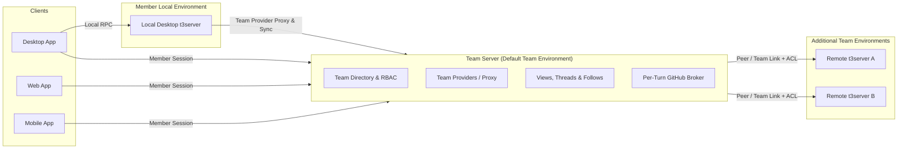

# Teams Architecture & Technical Specification

This document specifies how team features integrate into T3 Code's existing architecture (`apps/server`, `packages/contracts`, `packages/client-runtime`, `apps/web`, and `apps/desktop`), while remaining wire-compatible with the **unmodified upstream mobile app** (`apps/mobile` is intentionally not forked).

It builds directly on T3 Code's core invariants:

- Execution stays in the environment that owns the workspace ([01_architecture.md](../internals/01_architecture.md)).
- Every RPC and subscription is server-authorized ([04_environment-auth.md](../internals/04_environment-auth.md)).
- Orchestration mutations flow through event-sourced commands, projections, and outbox effects (`apps/server/src/orchestration-v2`).
- Shared client state and connection management live in `packages/client-runtime` ([09_connection-runtime.md](../internals/09_connection-runtime.md)).

---

## 1. Topology & Ownership Model



### Key ownership rules

1. **One Team Server is the source of truth.** A Team is defined in client settings by linking to a remote `t3server`. That server owns:
   - Team metadata, members, pseudos, and roles.
   - Invite links (deep links) and member sessions.
   - Views (visibility + posting rules).
   - Team-scoped provider configurations.
   - The registry of additional remote environments linked to the team and their per-environment ACLs.
   - Team project assignments, thread ownership (`creatorMemberId`), thread `viewId`, lock state, per-member follow subscriptions, and per-member snooze state.
2. **Default team environment.** The Team Server can act as the default execution environment for simple/dev setups, or run in **`--team-hub-only` (Control Plane) mode** where an unprivileged runner (`t3runner`) attached over loopback serves as the Default Team Environment (required for true OS-level RBAC enforcement; see [Agent Privilege Containment](#agent-privilege-containment-mcp--hubrunner-os-split)).
3. **Additional remote environments.** Team owners/admins can register other remote `t3server` instances on the Team Server (building on T3 Code's existing peer-link / remote-environment model in `apps/server/src/peer`).
4. **Local + remote thread placement.** When starting a new thread on a project assigned to a team, the user can choose:
   - Their **local environment** (the desktop app's bundled server), or
   - Any **remote environment** attached to the team (including the default team environment) that the user's role/whitelist permits them to access.

---

## 2. Identity, Joining, and Pseudos

### Member model

Upstream T3 Code's `SessionStore` binds sessions to scopes (`AuthEnvironmentScope`), not to named human users. For teams, we extend authentication with a first-class **Member principal**:

- `memberId`: immutable UUID/ULID generated on the Team Server. All ownership, ACL whitelists, follows, and audit trails reference `memberId`—never the mutable display pseudo.
- `pseudo`: unique-per-team handle (normalized/trimmed, e.g., `^[a-zA-Z0-9._-]{2,32}$`). Used in UI thread prefixes (`pseudo: <title>`), member pickers, and whitelists.
- `role`: `"owner" | "admin" | "modo" | "regular"`.
- `status`: `"active" | "suspended" | "removed"`.
- Every `SessionStore` row created via a team invite or member login carries `memberId`. The server resolves the acting member exclusively from the authenticated session—client payloads cannot spoof `memberId` or `pseudo`.

### Joining a team

Two supported flows:

1. **Deep-link invite (primary):**
   - An `owner`, `admin`, or `modo` (up to their own role) generates a one-time or bounded-use invite link on the Team Server, optionally prefilling `pseudo` and setting the granted `role`.
   - Format: `t3code://team/join?server=<encoded-url>&token=<invite-token>&pseudo=<optional-pseudo>` (and a hosted-web equivalent using URL fragment `#token=...` so the secret never hits a hosted origin, matching [05_remote.md](../internals/05_remote.md#hosted-web-is-a-client)).
   - Opening the link in the desktop/web app opens a Join Team modal with the server URL and prefilled `pseudo` (editable by the joining member). Confirming exchanges the invite token for a member-bound DPoP/bearer session. _(The unmodified upstream mobile app connects via a standard member-bound pairing QR/code generated from a member's desktop/web session; see [Upstream Mobile App Compatibility](#upstream-mobile-app-compatibility-no-mobile-fork).)_
2. **Manual setup in Settings:**
   - In **Settings → Teams → Add Team**, the user enters the Team Server URL, invite token / pairing credential, and chooses their `pseudo`.
   - The server validates pseudo uniqueness and creates/binds the member session.

### Team identity & scheduled thread prefix

- Every Team created on a Team Server has a team `name` (required, e.g., `Acme Engineering`). There is **no separate team `displayName` field**.
- Team-owned threads (such as threads created by Team Scheduled Tasks) render dynamically with the fixed prefix **`scheduled: <title>`** (e.g., `scheduled: Nightly triage`), keeping automated threads immediately identifiable and decoupled from any individual human member.

### Auto-attribution

- **Thread creation (human):** Every thread created by a member on a team project automatically stamps `ownerKind = "member"` and `creatorMemberId = session.memberId` in `team_thread_meta`.
- **Thread creation (team scheduled task):** Every thread created by a team scheduled task stamps `ownerKind = "team"` and `creatorMemberId = null` (never attributed to the human who configured the schedule).
- **Turns / prompts:** Every human user message / turn command stamps `authorMemberId = session.memberId`; automation-triggered turns record `authorKind = "team_automation"` (`authorMemberId = null`).
- **UI rendering:** Member-owned team threads render dynamically as `${creatorPseudo}: ${title}`; team-owned scheduled threads render dynamically as `scheduled: ${title}`. Storing attribution separately from `title` avoids double-prefixing and stays accurate if a member changes their pseudo.

---

## 3. Roles, Permissions, Views, and Locking

### Role hierarchy

```text
owner (4) > admin (3) > modo (2) > regular (1)
```

#### Role assignment rules

- Member invitation and role management start at `modo` (`regular` members cannot invite users or change roles).
- A member with role $R \ge \text{modo}$ may assign any role $R' \le R$ to another member.
- **Safety guardrails:**
  - A member cannot modify or demote a member whose current role is strictly higher than their own ($R_{\text{target}} > R_{\text{actor}}$).
  - The team must always retain at least one active `owner` (the server rejects demoting or removing the last `owner`).
  - Invite links follow the same ceiling: a member with role $R \ge \text{modo}$ can only mint invites with role $\le R$.

#### Capability matrix

| Action                                                                               | `regular`       | `modo`              | `admin`                    | `owner`             |
| ------------------------------------------------------------------------------------ | --------------- | ------------------- | -------------------------- | ------------------- |
| Join team, manage own pseudo & GitHub token                                          | Yes             | Yes                 | Yes                        | Yes                 |
| Follow / unfollow readable teammate or scheduled threads                             | Yes             | Yes                 | Yes                        | Yes                 |
| Snooze / unsnooze own or followed threads (per-member, isolated)                     | Yes             | Yes                 | Yes                        | Yes                 |
| Invite members / assign role $\le$ own role                                          | No              | `regular`, `modo`   | `regular`, `modo`, `admin` | All roles           |
| Create / edit / delete Views                                                         | No              | No                  | Yes                        | Yes                 |
| Change a thread's View                                                               | No              | Yes                 | Yes                        | Yes                 |
| Create locked thread / lock & unlock threads                                         | No              | No                  | Yes                        | Yes                 |
| Interrupt another user's ongoing turn                                                | No              | Yes* (unlocked)     | Yes*                       | Yes*                |
| `Send now` (steer queued message/note)                                               | Creator only    | Creator only        | Creator only               | Creator only        |
| Manage team skills & pre-prompts                                                     | No              | Yes                 | Yes                        | Yes                 |
| View team scheduled tasks (accessible env/view)                                      | Read-only       | Yes                 | Yes                        | Yes                 |
| Create / edit / delete / Run now (`minimal`) scheduled tasks                         | No              | Yes                 | Yes                        | Yes                 |
| Configure `elevated` MCP / `locked` scheduled tasks & team automation GitHub account | No              | No                  | Yes                        | Yes                 |
| Post in unlocked team-owned (scheduled task) thread                                  | `view.postRule` | Yes (no `Send now`) | Yes (no `Send now`)        | Yes (no `Send now`) |
| Configure team providers & remote environments                                       | No              | No                  | Yes                        | Yes                 |
| Configure per-environment ACLs                                                       | No              | No                  | Yes                        | Yes                 |
| Leave team (except last active `owner`)                                              | Yes             | Yes                 | Yes                        | Yes (if ≥2 owners)  |
| Delete team / transfer last owner                                                    | No              | No                  | No                         | Yes                 |

_\*`owner`, `admin`, and `modo` (on unlocked threads they can read) cannot click `Send now` (steer) on another member's thread; they have an explicit **Interrupt** action instead (immediately revoking the active turn's GitHub credential lease). See [Section 6](#6-per-turn-github-identity-forwarding--turn-isolation)._

### Views (server-enforced read & post policies)

> **Important distinction:** Upstream `packages/client-runtime/src/savedViews.ts` implements _client-side saved filter views_. Team **Views** are a distinct, **server-enforced authorization concept**—we should name them clearly in code (e.g., `TeamView` / `teamViewId`) to avoid confusion.

Every team has at least one built-in **Default View** (`isDefault: true`, cannot be deleted):

- **Default View read policy:** All team members can see threads in the Default View.
- **Default View post policy:** All team members can post in each other's threads in the Default View by default (`owner`/`admin` can tighten this later if desired).

Each `TeamView` defines two independent access policies:

```ts
interface AccessRule {
  /** Minimum role or explicit set of roles allowed. */
  roles: ReadonlyArray<TeamRole>;
  /** Explicit memberIds granted access regardless of role. */
  memberIds: ReadonlyArray<MemberId>;
}

interface TeamView {
  id: TeamViewId;
  teamId: TeamId;
  name: string;
  description?: string;
  isDefault: boolean;
  /** Who can see threads in this view (and create new threads in it). */
  readRule: AccessRule;
  /** Who can post in OTHER members' threads in this view. */
  postRule: AccessRule;
}
```

#### Authorization evaluation rules (enforced server-side)

1. **Read access (`canReadThread`):**
   - `owner` and `admin` can always read all views/threads (or opt-in, at minimum `owner` always has full visibility so nothing is orphaned).
   - Otherwise, member matches `view.readRule` (`roles.includes(member.role) || memberIds.includes(member.id)`).
   - **Critical:** Enforcement happens on the server in `subscribeShell`, `subscribeThread`, `searchThreads`, `getThreadProjection`, `getTurnDiff`, `getThreadTitles`, and asset/artifact endpoints—never just hidden in the UI.
2. **Thread creation (`canCreateThreadInView`):**
   - Any member who satisfies `view.readRule` can create a thread in that view.
   - Creating a **locked** thread requires `owner` or `admin`.
3. **Posting in a thread (`canPostInThread`):**
   - First, the member must satisfy `canReadThread`.
   - If `thread.locked === true`: **only `owner` and `admin`** can post (even if the member is the thread creator).
   - If `thread.locked === false`:
     - The thread creator (`thread.creatorMemberId === member.id`) can post in their own thread.
     - Any other member must satisfy `view.postRule`.
   - Viewing a thread never implies posting rights; the UI disables/hides the composer with a clear read-only indicator when `canPostInThread` is false, and the server rejects `dispatchCommand` with an authorization error.
4. **Changing a thread's View (`canChangeThreadView`):**
   - Allowed for `owner`, `admin`, and `modo` (provided they have access to the target view).
   - Moving a thread to a narrower view immediately updates live shell/thread subscriptions so unauthorized connected clients drop the thread from their state.
5. **Locking / unlocking (`canToggleThreadLock`):**
   - Allowed for `owner` and `admin`. Emits an orchestration event so all connected clients update immediately.

---

## 4. Team Projects, Environments, and Team Providers

### Assigning a project to a team

- Project creation (and project settings) gains an optional `teamId` selector (default: personal / no team).
- A team-assigned project stores `{ teamId, defaultViewId? }` in its project metadata on the Team Server and links clones across environments using T3 Code's existing repository identity correlation ([05_remote.md](../internals/05_remote.md#identity-is-independent-of-the-route)).

### Local vs. remote execution & thread syncing

- When a member starts a thread on a team-assigned project using their **local environment**, **the thread is synced into the Team Server's team thread list** (with its `creatorMemberId`, `viewId`, and mirrored transcript/status updates) so colleagues with access to that View can see it alongside remote threads.
- The key difference between starting a thread on a **local environment** vs. a **remote team environment** is **where tool calls and agent execution run** (e.g., testing changes locally on a developer's laptop vs. running on a shared remote server).
- **Absolute local-execution boundary:**
  - The local desktop server pushes thread metadata and transcript updates to the Team Server so the thread stays visible in the team thread list even when the developer's laptop goes offline (colleagues see the synced history in read-only mode while offline).
  - Tool calls on a local-environment thread execute **exclusively** on the owner's local machine. **No other team member—not even `owner` or `admin`—can execute turns or tool calls on another member's local environment.**

### Inaccessible environments, Thread Notes & Anti-Prompt-Injection Flow

Whenever a member can read a team thread (via its View) **but cannot execute turns on its attached environment**—either because it runs on another member's **local environment** (blocked for everyone else, including `owner`/`admin`) or because it runs on a **remote team environment restricted by ACL**—the thread remains fully readable, with a unified safe collaboration UX:

#### Colleague UX (no execution access)

- The standard prompt composer is **disabled/greyed out**, with a highlighted localized (`team.*`) banner directly above it:
  > _You cannot prompt this thread because it is attached to an environment you do not have access to (**\<environment label, e.g., Jean's local environment\>**). You can fork it or leave a note._
  >
  > `[ Fork this thread ]` `[ Leave a note ]`
- **Fork this thread:** Opens a quick picker of environments the colleague _does_ have access to (their own local environment or an accessible team environment) and creates a new thread owned by them via T3 Code's portable context handoff, linked back to the source thread.
- **Leave a note** _(available when the thread is unlocked for the actor and the View grants `postRule`)_:
  - Switches the composer **in place** into Note Mode (no blocking modal) with a distinct visual accent and `Send note` / `Cancel` controls.
  - Appears inline in the thread timeline at its chronological position as a distinct card labeled **`Note from <pseudo>:`** with a `Pending` status pill, and notifies the thread owner (Milestone 2).

#### Security model (anti-prompt-injection & race-condition proof)

1. **Author immutability + `contentHash` (no bait-and-switch):**
   - A note's `body` is **immutable** for its author after creation (the author may only delete a `pending` note, never edit it).
   - The server computes `original_content_hash` (SHA-256) at creation so an author can never swap benign text for a prompt injection while the owner is approving it.
2. **Owner edit-before-use:**
   - The thread owner / environment executor (e.g., Jean) **can edit a pending note** if they want to adjust part of it before sending it to the agent.
   - The edit is stored separately (`edited_body`, `edited_content_hash`) while preserving `original_body` for audit transparency (displayed as `Note from Paul (edited by Jean):`).
3. **Role-based confirmation friction (`regular` vs. `modo`+):**
   - **Author is `regular`:** Because newly onboarded / `regular` members carry higher prompt-injection risk, **accepting the note or applying an edit requires an explicit UI confirmation dialog** displaying the exact full text that will be passed to the agent on the owner's environment.
   - **Author is `modo`, `admin`, or `owner`:** Trusted roles skip the extra confirmation modal—accepting, editing, or using the 1-click **Accept & Send** action executes immediately.
4. **Zero implicit model injection:**
   - The orchestrator **never** pulls `pending` or `rejected` notes into the LLM prompt.
   - Every turn dispatch explicitly passes `acceptedNotes: Array<{ noteId, contentHash }>` (matching `edited_content_hash ?? original_content_hash`), verified server-side / by the executor before building the model prompt.
   - Accepted notes are clearly attributed in the prompt (`[Note from Paul (approved by Jean)]: ...`) and permanently bound to `included_in_turn_id`.
   - Rejected notes remain visible in chronological order (muted/collapsed with a `Rejected` pill) and are never sent to the model.
5. **Empty prompt allowed with accepted note(s):**
   - When at least one note is `accepted` (and not yet consumed by a turn), the owner may submit an **empty prompt** (`""`) so a colleague's suggested prompt can be executed directly without adding redundant text.
6. **Concurrent-arrival race condition (TOCTOU protection):**
   - If Paul posts a note `N` milliseconds before Jean hits Send (so `N` is not in Jean's `acceptedNotes` payload):
     - Jean's turn is **not** blocked with an error and **must ignore `N`** completely.
     - The server atomically **re-anchors `N` after the new turn** (`anchor_turn_id = newTurnId`) so `N` appears chronologically _after_ Jean's turn in the history, still `pending` for Jean's next turn.
   - Notes arriving while a turn is already running similarly anchor after the active turn (`anchor_turn_id = activeTurnId`) and never auto-steer the active turn. If the owner approves a note while a turn is still running, the approved note is appended to the thread's **queue** with a **dashed border/style** (`en pointillé`) and exposes **`Send now`** (mid-turn steering) strictly to the **thread creator only**.

#### Owner UX (fluid, minimal friction)

- Pending note cards show inline actions directly in the timeline: **`Accept`**, **`Edit`**, **`Reject`**, plus a 1-click **`Accept & Send`** shortcut when the owner's composer is empty (subject to the confirmation dialog if the author is `regular`).
- If the owner types a prompt while visible pending notes remain undecided, a compact 1-line bar appears above the composer (`1 pending note from Paul — decide before sending`) and disables Send until visible pending notes are resolved. Until Send is clicked, accepted/rejected states remain toggleable.

### Team Environments & per-environment ACLs

- The Team Server maintains a `team_environments` table:
  - Entry 0: the Team Server itself (`isDefault: true`).
  - Additional entries: remote `t3server` instances attached by `owner`/`admin`.
- Each environment has an `accessRule: AccessRule`:
  - **Default:** all roles (`["owner", "admin", "modo", "regular"]`) — everyone on the team can access it.
  - **Restricted:** `owner`/`admin` can restrict an environment to specific roles and/or whitelisted `memberIds` (e.g., production/staging box restricted to `admin` + two senior devs).
- **Enforcement:**
  - The client only displays environments the current member can access in the "New Thread → Environment" picker.
  - Launching a thread on a remote team environment goes through the Team Server's authorization check (or validates a short-lived team-signed environment grant) before the target environment starts the thread.

### Team Providers across all environments (Zero-Config for Teammates)

Requirement: _Settings allow configuring model providers per team, authentication is performed **only once by an `owner` or `admin` on the Team Server**, and all threads on a team-assigned project automatically and transparently use the team's configured providers on **any** environment (including a teammate's local machine)—never the teammate's personal subscription._

This solves the real-world case where a developer has a personal subscription (e.g., personal Gemini in local Antigravity) while the company has a team subscription on the shared Team Server:

1. **Single point of authentication (Team Server only):**
   - Only `owner` and `admin` members configure and sign in to team providers in **Settings → Teams → \<Team\> → Providers** on the owning Team Server.
   - Regular / `modo` teammates **never** sign in to team providers, enter team API keys, or manage team provider auth locally or on attached remote environments.
2. **Isolated virtual local instances (`team:<teamId>:<providerInstanceId>`):**
   - When a teammate joins a team, their local `t3server` automatically syncs the team's provider catalog and provisions isolated virtual provider instances keyed as `team:<teamId>:<providerInstanceId>` (leveraging T3 Code's native multi-instance directory isolation: separate `GEMINI_HOME`, `CODEX_HOME`, and `CLAUDE_CONFIG_DIR` from the user's personal instances, with ambient env vars stripped).
   - **Strict isolation invariant:** On any project assigned to team `T`, the model picker and orchestrator allow **only** `team:<T>:*` instances. A thread on a team project must **never** expose or silently fall back to the teammate's personal provider credentials.
3. **Automatic credential delivery to local & attached remote environments (two strategies):**
   - **Strategy A — `proxy` (API-key & `BASE_URL` providers: Anthropic API, OpenAI API, Gemini API / Vertex, OpenRouter, LiteLLM, custom gateways):**
     - The Team Server exposes an authenticated **Team Model Proxy** (`/api/team/provider-proxy/:providerInstanceId/...`).
     - Any execution environment (local laptop or attached remote environment) points its `team:<teamId>:*` instance's `BASE_URL` at the Team Server proxy using the member's team session token; the Team Server injects the real company API key server-side.
     - **Security:** Zero company secrets ever touch a teammate's laptop; revoking a member cuts off model access immediately; cost/usage accounting is centralized per member.
   - **Strategy B — `token-lease` (OAuth subscription harnesses: Antigravity/Gemini, Codex ChatGPT, Claude OAuth):**
     - The Team Server is the sole holder of the company's OAuth `refresh_token`—**a `refresh_token` never leaves the Team Server**.
     - Before starting/resuming a turn (or when a lease approaches expiry), the local or remote `t3server` calls `POST /api/team/provider-lease/:providerInstanceId` with the member's session token.
     - If the Team Server's cached OAuth `access_token` is near expiry (e.g., `< 10 min` remaining), the Team Server refreshes it server-side, **strips `refresh_token`**, and returns only the short-lived `{ access_token, expiry }` (~1 hour lifetime):
       - **Codex:** injected in memory via T3's existing Unix-socket broker (`CodexManagedTokenBroker.ts` / `__managed-chatgpt-token`)—zero token written to disk.
       - **Antigravity (Gemini):** written transiently (`chmod 0600`) to the isolated `team:<teamId>:antigravity` profile's `antigravity-oauth-token` (`{ token: { access_token, token_type, expiry, expires_in }, auth_method, id_token_email }`) with `refresh_token` **completely stripped** (empirically verified against `agy acp` with `GEMINI_HOME` + `SSH_CONNECTION` + `AGY_ACP_FORCE_FILE_STORAGE=1`: completes `initialize`, `session/new`, and `session/prompt` with zero OS-keyring fallback), refreshed automatically before `expiry` (recycling the warm ACP session on lease rotation so the running process picks up the fresh token), and purged on idle/disconnect/team leave.
       - **Claude OAuth:** injected into the isolated `CLAUDE_CONFIG_DIR` (`CLAUDE_CODE_OAUTH_TOKEN` / `.credentials.json`) without `refreshToken`.
     - **Security:** Revoking a member from the team immediately prevents future leases, and any existing short-lived access token expires permanently within ≤ 1 hour.
     - **Long-running local turns (> 1 hour) & seamless continuity:**
       - **Proactive pre-turn & background renewal:** Before starting a turn, if the cached lease has `< 15 min` remaining, the local `t3server` refreshes the lease first (and recycles any warm process that caches tokens in RAM) so every new turn starts with a fresh ~50–60 min window. While a session is active, a background timer at `expiry - 10 min` proactively calls `POST /api/team/provider-lease/:providerInstanceId` and atomically updates the isolated credential file / in-memory cache.
       - **Zero-interruption harnesses:** Codex (`CodexManagedTokenBroker.ts`) and `proxy`-mode providers fetch the fresh token on demand mid-turn without interrupting execution.
       - **Transparent auto-resume for RAM-caching harnesses (e.g., `agy acp`):** If an active turn hits an auth/expiry error (`401` / `UNAUTHENTICATED` / sign-in required) after > 1 hour because the running child process cached the earlier `access_token` in RAM, the local orchestrator requests a fresh lease (`forceRefresh: true`), atomically rewrites the isolated token file, restarts the child process and resumes the exact session (`session/load` from the isolated profile's local conversation DB), and triggers an internal continuation via `ProviderContinuationRequests` so work continues seamlessly without user intervention.
       - **Revocation handling:** If the Team Server responds `403` during renewal or auto-resume (member revoked/suspended), the local `t3server` purges the ephemeral token, skips auto-resume, and surfaces a clear team-access-revoked error.
   - **Safe fallback (`remote-only`):** If a specific CLI driver cannot be proxied or leased without exposing a long-lived `refresh_token`, the Team Server marks it `remote-only` and the UI clearly explains it runs only on remote team environments—never falling back to personal subscriptions.

### Team Skills & Pre-Prompts (Auto-Synced to Local & Remote Environments)

`owner`, `admin`, and `modo` members can define shared **Skills** and **Pre-prompts** in **Settings → Teams → \<Team\> → Skills & Pre-prompts**, scoped either to **all providers (`"*"`)** or to a **specific provider driver** (e.g., `"antigravity"`, `"codex"`, `"claudeAgent"`). Any teammate running a local thread (or remote team thread) on a team-assigned project automatically uses them with zero local setup:

1. **Pure Markdown skills only (security boundary):**
   - Team skills consist strictly of **pure Markdown** (`SKILL.md` with YAML frontmatter + optional text/Markdown reference files)—never executable scripts or binaries distributed from the Team Server to teammates' laptops (executable tooling belongs in the project's git repository under normal PR review).
   - Every create/update records `updated_by_member_id`, `updated_at`, `revision`, and `content_hash` for auditability.
2. **Pre-prompt injection scope (`"thread"` vs. `"turn"`):**
   - Each team pre-prompt specifies `injection_scope: "thread" | "turn"` (default `"thread"`):
     - **`"thread"` (once per thread/session):** Materialized into the isolated profile's global instruction file (`<teamProfile>/GEMINI.md`, `<teamProfile>/CLAUDE.md`, `<teamProfile>/AGENTS.md`) or injected once on Turn 1 for generic ACP agents — stays prefix-cached with zero per-turn token overhead (ideal for team conventions, architecture context, coding standards).
     - **`"turn"` (every turn):** Re-injected on **every turn** via the orchestrator's turn-input envelope (`<team_turn_instructions>` / Codex per-turn `additionalContext`) so critical operational guardrails survive long conversations and context compaction (ideal for short, high-priority rules like verification requirements or response style).
   - A team may define both `"thread"` and `"turn"` pre-prompts (each scoped to `"*"` or a specific driver such as `"antigravity"`).
3. **Materialization into isolated `team:<teamId>:*` profiles (personal config untouched):**
   - Teammates' personal config directories (`~/.gemini`, `~/.codex`, `~/.claude`) are **never modified or overwritten**.
   - Team skills and `"thread"`-scoped pre-prompts are materialized exclusively inside the isolated `team:<teamId>:<providerInstanceId>` profile directory (and purged cleanly if the member leaves or is revoked from the team):
     - **Antigravity (`GEMINI_HOME`):** Team skills (`"*"` + `"antigravity"`) are written atomically to `<teamProfile>/team-skills/<slug>/SKILL.md` (+ references). `<teamProfile>/config/skills.json` registers `<teamProfile>/team-skills` **first** and keeps the user's personal skills directory (`~/.gemini/config/skills`) accessible alongside it, with **team skills taking precedence on slug/name collision**. `"thread"` pre-prompts (`"*"` + `"antigravity"`) are written to `<teamProfile>/GEMINI.md` (alongside repo-level `AGENTS.md`/`GEMINI.md` loaded natively by the harness), while `"turn"` pre-prompts are injected on every turn.
     - **Codex (`CODEX_HOME`):** Materialized into `<teamProfile>/skills/` (team slugs overriding personal symlinks on collision) + `<teamProfile>/AGENTS.md` for `"thread"` pre-prompts, and `buildCodexAdditionalContext` (respecting its 4,000-byte entry cap) for `"turn"` pre-prompts.
     - **Claude Code (`CLAUDE_CONFIG_DIR`):** Materialized into `<teamProfile>/skills/` (team precedence on collision) + `<teamProfile>/CLAUDE.md` / `--append-system-prompt` for `"thread"` pre-prompts, and `<team_turn_instructions>` per turn for `"turn"` pre-prompts.
     - **Generic / ACP agents:** `"thread"` pre-prompts are injected once on session start (`<team_instructions>`) and `"turn"` pre-prompts on every turn (`<team_turn_instructions>`).
4. **Real-time & pre-turn sync:**
   - Any create/update/delete on the Team Server increments the team asset revision and broadcasts a lightweight `team.assets.updated { revision }` WebSocket event.
   - Connected local `t3server` instances and remote runners fetch deltas via `GET /api/team/assets?since=<revision>`, update their isolated `team:<teamId>:*` profile atomically, and refresh the provider's skill catalog so new skills appear immediately in the `/` picker.
   - A revision check also runs right before starting or resuming a turn so offline laptops catch up transparently on reconnect.

### Team Scheduled Tasks (`(team, env)` Scoping & Automation Ownership)

Upstream T3 Code scopes scheduled tasks solely by `environmentId`. In the Teams fork, scheduled tasks are scoped by **`(team, environment)`**:

1. **`(team, env)` scoping & hidden virtual `"personal"` team:**
   - Every scheduled task belongs conceptually to a `(teamScope, environmentId)` pair:
     - **Non-team / personal environments:** resolved internally in code to a virtual `"personal"` team scope (`kind: "personal"` / `teamId: null`), **completely hidden in the UI** so personal scheduled tasks look and behave 100% identically to upstream.
     - **Team environments:** stored in a sidecar table `team_scheduled_task_meta` (`task_id`, `team_id`, `environment_id`, `view_id`, `locked`, `mcp_access_level`, `created_by_member_id`, `updated_by_member_id`, `updated_at`) without altering upstream's `scheduled_tasks` table.
   - In **Settings → Scheduled Tasks** and `ThreadAutomationsPanel`, team scheduled tasks are grouped/filtered by **Team** and **Environment**; personal environments never display the virtual `"personal"` label.
2. **RBAC on Team Scheduled Tasks:**
   - **Read:** Any active member with access to both the task's `environmentId` (per `team_environments.accessRule`) and its target `viewId` (`canReadTeamView`) sees the scheduled task (`regular` members in **read-only** mode).
   - **Create / edit / enable-disable / delete / `Run now`:** Allowed for **`owner`, `admin`, and `modo`** (within environments and Views they can access).
   - **Privileged task options (`owner` & `admin` only):** Only `owner` and `admin` may mark a task's generated threads as `locked`, set `mcpAccessLevel = "elevated"`, or edit/delete an existing `elevated` or `locked` scheduled task (preventing a `modo` from modifying the prompt or webhook template of an `elevated` task to escalate privileges).
3. **Team-owned threads (`ownerKind: "team"`), sidebar visibility, and posting rules:**
   - Threads created by a team scheduled task are attributed to the **team itself** (`ownerKind = "team"`, `creatorMemberId = null`), **never** to the member who configured the task. They display everywhere with the fixed prefix **`scheduled: ${title}`** (e.g., `scheduled: Nightly triage`).
   - **Sidebar & Notifications:** Hidden by default in the sidebar just like colleagues' threads (revealed via the "All team threads" toggle or when explicitly followed via `Follow`), producing **zero** notifications unless the member follows the thread (or authors a follow-up turn on it).
   - **Posting, `Send now`, and `Interrupt`:**
     - If `locked === true`: only `owner` and `admin` may post.
     - If `locked === false`: **`owner`, `admin`, and `modo`** may always post in a team-owned scheduled-task thread (provided they can read its View); `regular` members may post when `view.postRule` permits.
     - **No `Send now` for `modo` (or on automation runs):** Mid-turn messages posted by `modo` (as well as `regular`, `admin`, `owner`) during an active automation run enter the native dashed queue (`QueuedRunsControl.tsx`) and never auto-steer; `modo` can never click `Send now` on a team-owned thread.
     - **`Interrupt`:** `owner` and `admin` may always interrupt an active automation run; `modo` may interrupt an active automation run on an **unlocked** thread they can read (human follow-up turn authors retain stop control over their own turn; `regular` members cannot interrupt automation runs or colleagues' turns).
4. **MCP privilege containment for scheduled task runs (`team-automation` principal):**
   - Scheduled task runs execute under a dedicated synthetic MCP principal **`team-automation`** (never inheriting the configuring member's personal session/role).
   - Each task defines `mcpAccessLevel: "minimal" | "elevated"` (default **`"minimal"`**):
     - **`"minimal"` (default):** Equivalent to `regular`, further narrowed strictly to the task's `projectId`, `environmentId`, and target `viewId` — cannot read `admin`-only Views, manage team members/views/settings, or edit scheduled tasks.
     - **`"elevated"` (opt-in, `owner`/`admin` only):** Explicitly grants broader admin-level MCP capabilities for trusted internal automation tasks; immutable by `modo` (cannot edit prompt, schedule, webhook, or target of an `elevated` task).
5. **Dedicated optional GitHub identity for Team Scheduled Tasks:**
   - Team scheduled tasks **never** borrow a human member's personal GitHub PAT/OAuth token.
   - `owner`/`admin` may optionally configure a **dedicated team automation GitHub account** (fine-grained PAT or GitHub App bot token encrypted in `ServerSecretStore` under `teamId`).
   - **No GitHub account configured is valid and allowed:** If no team automation GitHub account is configured, the turn credential broker returns **no GitHub credentials** during scheduled task runs (cleanly supporting tasks that only inspect code, run checks, or report findings without GitHub access).
   - When a human member posts a follow-up turn in a team-owned thread, the author switch (`team-automation` → `memberId`) triggers the standard warm session recycle and switches both the MCP token and the per-turn GitHub broker to that human member's identity.

---

## 5. UI, Filtering, and Notifications

Following `AGENTS.md` ("Hit every surface"), every user-facing team feature must cover sidebar/chat, Settings, command palette, keybindings, and web/desktop clients via `packages/client-runtime`, while preserving clean degradation for the unmodified upstream mobile app via the server compatibility layer below.

### Thread list & filtering

- **Pseudo prefix:** Every team thread renders as `pseudo: <title>` (with subtle visual distinction for the pseudo badge/prefix so titles stay scannable).
- **Default filter:** In team projects, the sidebar defaults to **"My threads"** (threads where `creatorMemberId === currentMemberId`, plus optionally threads the user follows).
- **Show/Hide colleagues' threads toggle:** A prominent, persistent toggle in the sidebar header / project filter bar (plus command palette action & keyboard shortcut) switches between:
  - **My threads only** (default)
  - **All team threads** (all threads visible to the user across their accessible Views)
  - Optional secondary filters: by **View** and by **Member pseudo**.
- **Thread metadata badges:** Show the thread's current **View** pill (clickable by `modo`/`admin`/`owner` to change view) and a **Lock** icon (clickable by `admin`/`owner` to lock/unlock).

### Notifications, Following & Per-Member Snoozing

- **Default rule:** A member receives desktop/web/mobile notifications for a team thread **only if** (and only while that member has not snoozed the thread):
  1. They are the thread's creator (`creatorMemberId === currentMemberId`), **OR**
  2. They have explicitly **followed** the thread (`team_thread_follows` contains `(threadId, currentMemberId)`), **OR**
  3. _(Recommended ergonomic default)_ They posted the currently finishing turn in a colleague's thread (so you still get notified when _your_ prompt finishes, without subscribing to all future turns unless you follow).
- **Follow / Unfollow (every member, every environment):**
  - Any active team member (`owner`, `admin`, `modo`, `regular`) can **follow** and **unfollow** any readable colleague thread or team-owned scheduled thread—regardless of role, View `postRule` (read-only Views are followable), lock state, local-sync origin, or whether the thread runs on the Default Team Environment or an attached remote environment (`t3runner` / additional remote `t3server`).
  - Toggle button (bell icon) in the thread header (`TeamThreadFollowButton`), thread sidebar context/action menu, and command palette; client state resolves the owning Team Server via correlated thread location so attached remote environments route `team.followThread` / `team.unfollowThread` to the Team Server cleanly.
  - Stored server-side in `team_thread_follows` so follow state stays synced live across desktop, web, and mobile push notifications.
- **Per-Member Thread Snoozing (isolated per member):**
  - **Eligibility:** Any active team member (`owner`, `admin`, `modo`, `regular`) can **snooze** and **unsnooze** a readable team thread if they are its creator (`creatorMemberId === member.id`) **or** they are currently **following** it (`team_thread_follows` contains `(threadId, member.id)`). Snoozing requires only read access + creator/follower status—never `postRule`, unlocked state, or environment execution access—so a `regular` member following Charlie's locked, read-only, or local-synced thread can snooze it freely. Unsnoozing an existing own snooze row is always permitted (no one-way door).
  - **Strict per-member isolation (`team_thread_snoozes`):** On a Team Server, snooze state is stored strictly per `(threadId, memberId)` in sidecar table **`team_thread_snoozes`** (`snoozed_until`, `snoozed_at`, `last_snooze_wake_at`, `updated_at`)—**never** mutating upstream's shared `threads.snoozed_until` column. Example: if **Alice** and **Bob** both follow **Charlie's** thread and Alice snoozes Charlie's thread (or snoozes a notification from it), only Alice's `(threadId, aliceMemberId)` row is updated; **Bob** and **Charlie** see the thread completely unsnoozed and continue receiving notifications normally.
  - **Server-side interception & per-session projection overlay:**
    - On a Team Server, `thread.snooze` and `thread.unsnooze` (via WS `dispatchCommand` and member-bound MCP `t3_thread_organize`)—plus explicit `team.snoozeThread` / `team.unsnoozeThread` RPCs for threads hosted on attached remote environments (`t3runner` / remote `t3server`)—update only the acting member's row in `team_thread_snoozes` and emit member-scoped updates exclusively to that member's active sessions (keeping all of Alice's desktop/web/mobile devices in sync without broadcasting to Bob or Charlie).
    - Server read paths (`subscribeShell`, `subscribeThread`, `getThreadProjection`, `listThreads`, `searchThreads`, and MCP thread reads) overlay `snoozedUntil`, `snoozedAt`, and `lastSnoozeWakeAt` from `team_thread_snoozes` for the requesting session's `memberId` (defaulting to `null` when that member has no snooze). For threads on attached remote environments, clients merge the owning Team Server's per-member snooze state (`snoozedByThreadId`) onto the displayed thread shell.
    - Unfollowing a thread clears that member's own `team_thread_snoozes` row for that thread so an unfollowed thread never lingers in their `Snoozed` shelf.
  - **Notification suppression & Snooze from notification:**
    - Both server-side relay/push notification gating (`TeamService.listNotificationRecipientsForThread`, `shouldPublishRelayNotificationForThread`, `shouldPublishRelayQueuedMessageNotification`) and client-side `ThreadNotificationCoordinator` evaluate each recipient's own active snooze independently: while Alice has an active snooze on Charlie's followed thread, completion, attention/input, and queued-message notifications for that thread are suppressed for Alice while still firing normally for Bob and Charlie.
    - In addition to the sidebar hover/context menu, thread header menu, and command palette, in-app thread notification toasts expose a quick **Snooze** action (for owned or followed threads) so a member can snooze a teammate's thread directly from an incoming notification.
- **Implementation hook:** Filter notification emission both server-side (for relay/mobile push in `apps/server/src/relay/AgentAwarenessRelay.ts` + `TeamService.ts`) and client-side (`apps/web/src/components/ThreadNotificationCoordinator.tsx` + `apps/web/src/threadNotifications.ts`).
- **Per-team notification sounds (distinct from personal alerts):**
  - Personal threads retain upstream's exact default MP3 alerts (`classic`: `notification-completion.mp3` / `notification-input.mp3`).
  - Team threads (both remote Team Server threads and local threads on a team-assigned project) default automatically to a distinct **`chime`** preset so members can distinguish personal vs. team alerts by ear with zero setup.
  - Stored per-device in `ClientSettings` (`teamNotificationSounds: Record<TeamId, TeamNotificationSoundPreset>`, alongside `notificationMode`), requiring zero server schema changes and allowing each user to pick a distinct sound per team.
  - Curated Web Audio presets (each with distinct `completion` vs. `input`/attention tones): `chime` (team default), `bell`, `marimba`, `pulse`, `classic` (same as personal upstream sound), and `off` (mute sound for that team while keeping visual notifications).
  - Exposed with an inline **Preview** control in both **Settings → Notifications** and **Settings → Teams** (plus searchable settings).

### Upstream Mobile App Compatibility (No Mobile Fork)

To avoid the maintenance and App Store / Play Store release overhead of forking `apps/mobile`, **this fork does not modify or ship a custom mobile app**. Users install the official upstream T3 Code mobile app and connect it directly to their forked Desktop `t3server` and/or their Team Server:

1. **Additive wire protocol & stable-release alignment:**
   - Because all team RPCs (`team.*`) and sidecar tables are strictly additive and the fork tracks stable upstream releases (`vX.Y.Z`), the unmodified upstream mobile app communicates over the standard HTTP/WS protocol without breaking.
2. **Member-bound standard pairing QR/codes (`team_pairing_meta`):**
   - The upstream mobile app pairs via standard QR codes / pairing codes (`Settings → Sharing & access`), not `t3code://team/join`.
   - Whenever an authenticated team member creates a standard pairing link on a Team Server (e.g., via **Settings → Teams → Connect mobile** or `authCreatePairingLink`), the server attaches `memberId = caller.memberId` in `team_pairing_meta`. When the upstream mobile app redeems that pairing link, the resulting session is automatically bound to that `memberId` in `team_session_meta` (inheriting their pseudo, role, Views, Follows, filtered push notifications, and GitHub identity).
3. **Automatic non-team-aware client detection:**
   - Forked web/desktop clients send an explicit marker (e.g., `X-T3-Teams-Client: 1` header or WS handshake capability).
   - Any session connecting **without** this marker (typically the upstream mobile app, or upstream `app.t3.codes`) automatically activates the server-side **Upstream Client Compatibility Mode** (also leveraging `session.client.deviceType === "mobile"`).
4. **On-the-fly server-side data adaptation (database untouched):**
   - **Dynamic title prefixing & per-member snooze overlay:** In `subscribeShell`, `subscribeThread`, `getThreadProjection`, `searchThreads`, `getThreadTitles`, and push notification payloads, the server dynamically prefixes `thread.title` as `${creatorPseudo}: ${title}` (or `scheduled: ${title}` for team-owned scheduled-task threads) for non-team-aware clients while keeping the raw title in SQLite. If a non-team-aware client renames a thread, the server strips the matching leading prefix before persisting so titles never double-prefix (`alice: alice: ...` or `scheduled: scheduled: ...`). Per-member snooze overlay (`team_thread_snoozes`) also applies transparently on read and `thread.snooze` / `thread.unsnooze` dispatch, so upstream mobile clients snooze only for the acting member with zero mobile code changes.
   - **Per-member mobile thread visibility preference:** Because the upstream mobile app lacks our "Show colleagues' threads" sidebar toggle, each member can configure a preference in Desktop/Web **Settings → Teams** (**"Visible threads on upstream mobile"**: `My threads + followed` by default, or `All accessible team threads`), enforced server-side in `subscribeShell` for non-team-aware mobile sessions so the mobile sidebar stays focused and noise-free.
   - **Server-enforced security & clear errors:** Views (`canReadThread` / `canPostInThread`), thread locks, creator-only `Send now`, `owner`/`admin`/`modo` `Interrupt`, local-execution boundaries, and filtered push notifications all remain enforced server-side. Blocked mutations return clear, human-readable error messages (e.g., directing the user to Desktop/Web to leave a Note or fork an inaccessible-environment thread).

---

## 6. Per-Turn GitHub Identity Forwarding & Turn Isolation

### The problem to solve

In a shared environment, a single OS user runs the `t3server` and agent processes. Previously, all git/GitHub operations used one shared account (`msl-agent`) with manual commit co-signing. We want:

1. Every turn initiated by User A executes git/GitHub operations as **User A**.
2. If User B later posts a turn in the same thread, that turn executes git/GitHub operations as **User B**—never User A.
3. No other user can hijack an active turn's credentials via mid-turn steering.

### Credential storage & acquisition

- **Phase 1 (initial implementation):** Per-user **encrypted fine-grained PAT** configured in Settings. This requires zero OAuth App / GitHub App registration for self-hosted teams and unlocks per-user attribution immediately.
- **Phase 2 (follow-up):** **GitHub OAuth / GitHub App user-to-server tokens** for automatic short-lived token refresh and one-click sign-in.
- Tokens are encrypted at rest in the Team Server's `ServerSecretStore`, keyed by `memberId`, and never exposed to any other member or read model.
- **Dedicated Team Scheduled Task GitHub account (optional):** `owner`/`admin` may also configure a separate, optional team-level GitHub credential in `ServerSecretStore` specifically for `team-automation` scheduled-task runs. Scheduled tasks never use a human member's PAT; if no dedicated team automation GitHub account is configured, scheduled-task runs proceed with **no GitHub credentials** (broker returns empty).
- When a member initiates a turn on an **attached remote environment** (not the Team Server itself), the Team Server mints a **single-turn, short-lived, scoped credential lease** for that remote environment, valid only for the duration of that `turnId`.

### Per-turn injection without credential leakage

A critical subtlety in T3 Code: provider processes (Claude Code, Codex, etc.) often persist across multiple turns as a warm `Session`. Setting `GH_TOKEN=<userA>` on process startup would **leak User A's token into User B's turn**.

To prevent this, we combine **two layers of defense**:

1. **Dynamic Turn-Scoped Credential Broker (primary):**
   - The server exposes a local-only Unix socket or loopback broker endpoint authenticated with a per-session secret.
   - Provider child processes receive:
     - `GIT_ASKPASS=/path/to/t3-git-askpass` (a tiny helper that asks the server broker for the credential bound to the thread's _currently active turn_).
     - `GH_TOKEN` is **not** set as a static long-lived secret; instead, `gh` is configured via a wrapper / `GH_CONFIG_DIR` or credential helper backed by the same turn-scoped broker (or a turn-scoped ephemeral file rotated/deleted on turn start/end).
     - `GIT_AUTHOR_NAME`, `GIT_AUTHOR_EMAIL`, `GIT_COMMITTER_NAME`, `GIT_COMMITTER_EMAIL` set from the active turn author's GitHub profile (via per-turn git config / wrapper so `git commit` attributes commits natively to the real user—no more `msl-agent`!).
   - When no turn is active (or after the turn settles/cancels), the broker immediately returns **no credential**.
2. **Session recycling on author switch (belt-and-suspenders):**
   - If Turn $N$ in a thread is initiated by `memberId = B` and the warm provider session was last run by `memberId = A` ($A \neq B$), the orchestrator **stops the warm provider process and resumes the session in a fresh process** before starting Turn $N$.
   - This eliminates any risk of in-memory token caching, lingering background subshells, or environment variable leakage from User A's turn into User B's turn.
   - T3 Code's `Session` model already supports stopping and resuming a provider session without losing thread history ([00_glossary.md](../internals/00_glossary.md)).

### Mid-turn queueing, `Send now`, and steering isolation

- **Reuse upstream's native queue UI (`apps/web/src/components/chat/QueuedRunsControl.tsx` & `ChatView.tsx`):** T3 Code already renders queued turns sent during an active run with dashed styling and a `Send now` (`promote_to_steer` / `steerNext`) action. Team mode must reuse this exact native queued-run pipeline and UI component (adding only author pseudo attribution and creator-only gating on `Send now`) rather than building a separate queue UI.
- While a turn is actively running on a team thread:
  - **Messages from another member (not the thread creator)** on a shared environment — as well as **approved Notes** accepted while a turn is still running — **never auto-steer** the ongoing turn. They enter the native thread **queue** (rendered via `QueuedRunsControl.tsx` with its existing dashed border/style).
  - **Queued-message notification to thread creator / active turn author:** Whenever a member other than the thread creator / active turn author queues a message during an active turn, the server emits a notification (via `NotificationMailbox` / push + client `ThreadNotificationCoordinator`, never notifying the sender themselves) to the **thread creator** and the **active turn author** (when distinct and permitted to read the thread) so the creator can inspect the queued message and click **`Send now`** if they consider it acceptable.
  - **`Send now` (promote to mid-turn steering):**
    - Accessible **strictly to the thread creator only** (enforced both on the server and by gating `Send now` / `steerNext` in `QueuedRunsControl.tsx` — hidden/disabled for the colleague who sent the queued message and for `owner`/`admin`/`modo` on someone else's thread).
    - Clicking `Send now` promotes that queued message or approved note into mid-turn steering of the running turn. _(GitHub safety invariant: if the active turn was authored by someone other than the thread creator, steering immediately revokes that foreign turn's GitHub credential lease for the remainder of the turn.)_
  - **Explicit `Interrupt` for `owner`, `admin`, and `modo`:**
    - `owner`, `admin`, and `modo` (on unlocked threads they can read; locked threads remain `owner`/`admin` only) cannot use `Send now` on another member's thread, but they have an explicit **`Interrupt`** control to stop an ongoing turn—immediately revoking the active turn's GitHub credential lease so queued turns or a fresh turn can then run cleanly under their respective authors' identities.
  - **Normal queued execution:** When the active turn finishes naturally, queued turns execute in order, triggering the author-switch session recycle and using each queued turn author's own GitHub identity.

### Agent Privilege Containment (MCP + Hub/Runner OS Split)

Ensuring an agent running on the Default Team Environment (or any shared team environment) **cannot perform actions the triggering member is unauthorized to do** requires closing **two separate attack planes**:

#### Plane 1 — Member-bound, turn-scoped MCP tools (Application layer)

Every agent spawned inside T3 Code receives an injected T3 MCP server (`OrchestratorMcpService.ts` / `McpToolAccess.ts`) exposing `t3_thread_*`, `t3_project_*`, `t3_environment_*`, `delegate_task`, etc.:

- **Bind MCP tokens to `actingMemberId`:** Every turn injects an MCP credential bound strictly to `actingMemberId = turnAuthorMemberId` (never a privileged server/admin token).
- **Enforce identical RBAC/View/Lock/Env checks:** Every MCP tool handler runs the exact same authorization checks (`canReadThread`, `canPostInThread`, role hierarchy, View rules, Lock state, Environment ACLs) as if that human member called the RPC directly.
- **Immutable propagation & rotation:** Subagents and delegated tasks inherit `actingMemberId` immutably (narrowing only, never widening). When a different member triggers the next turn on the same thread, the session recycle also rotates the MCP token to the new `actingMemberId`.

#### Plane 2 — Control Plane vs. Execution Runner OS-user split (Host layer)

In T3 Code, the OS user running an environment is the filesystem boundary ([04_environment-auth.md](../internals/04_environment-auth.md#the-environment-is-the-filesystem-boundary)). If coding agents (with shell/file tools) run under the **same OS user** as the Team Server owning the team, an agent triggered by a `regular` member could bypass Plane 1 directly via shell commands (`sqlite3 statev2.sqlite` to read `admin`-only Views or escalate to `owner`, reading `ServerSecretStore` / company OAuth `refresh_token`s / colleagues' GitHub PATs, or running `t3 auth session issue`).

To prevent this **on a single shared company server**, separate the Team Control Plane from the Default Team Environment across two OS users (or containers):

1. **`t3hub` (Control Plane — `--team-hub-only`, data dir `chmod 700 t3hub:t3hub`):**
   - Owns `statev2.sqlite` (RBAC, Views, invites, transcripts), `ServerSecretStore` (GitHub PATs, company OAuth `refresh_token`s), Team Model Proxy, OAuth Token Lease endpoint, and GitHub per-turn broker.
   - **Never spawns coding agents or shell terminals directly.**
2. **`t3runner` (Default Team Environment — unprivileged OS user attached over loopback):**
   - Runs agent harnesses, terminals, and workspaces for the team.
   - Has **zero OS filesystem permission** to read `/var/lib/t3hub` and cannot mint sessions on `t3hub`.
   - Receives only: the turn's member-bound MCP token (`actingMemberId`), ephemeral `access_token` leases (no `refresh_token`), and single-turn GitHub leases.

#### Optional Layer 2 hardening between concurrent teammates on `t3runner`

- The `t3hub`/`t3runner` split completely protects the Team Server, RBAC, secrets, and `admin`-only View transcripts.
- To also prevent two agents running _concurrently_ on `t3runner` from reading each other's worktree files or inspecting sibling processes on Linux:
  - Mount `/proc` with `hidepid=2` and keep GitHub credentials in the turn-scoped Unix socket broker (never static process env vars).
  - Optionally wrap each agent child process in a lightweight Linux **`bwrap` (bubblewrap)** sandbox mounting **only** that thread's worktree, `/tmp`, and its turn broker socket (or run separate runner OS users per trust tier, e.g., `default-runner` vs. `admin-runner` gated by Environment ACL).

---

## 7. Data Model Sketch (Team Server SQLite)

To avoid SQLite migration number collisions and `ALTER TABLE` conflicts with upstream `pingdotgg/t3code`, **all team tables live under a `team_*` prefix and are managed by an independent migration table (`team_schema_migrations` in `apps/server/src/team/migrations.ts`)** rather than modifying upstream's migration sequence or altering upstream tables.

### Core team tables

- `team_workspaces` (`id`, `name`, `default_view_id`, `created_at`, `updated_at`) _(legacy `display_name` column from older DBs is ignored)_
- `team_members` (`id`, `team_id`, `pseudo`, `role`, `status`, `upstream_client_thread_visibility`, `github_login`, `github_name`, `github_email`, `created_at`, `updated_at`)
- `team_invites` (`id`, `team_id`, `token_hash`, `role`, `prefilled_pseudo`, `max_uses`, `uses`, `expires_at`, `created_by_member_id`, `revoked_at`)
- `team_views` (`id`, `team_id`, `name`, `is_default`, `read_roles_json`, `read_member_ids_json`, `post_roles_json`, `post_member_ids_json`, `created_at`, `updated_at`)
- `team_environments` (`id`, `team_id`, `environment_id`, `name`, `is_default`, `peer_link_id`, `access_roles_json`, `access_member_ids_json`, `created_at`, `updated_at`)
- `team_providers` (`id`, `team_id`, `provider_instance_id`, `config_json`, `proxy_enabled`, `created_at`, `updated_at`)
- `team_skills` (`id`, `team_id`, `slug`, `provider_driver`, `skill_md`, `references_json`, `enabled`, `revision`, `content_hash`, `updated_by_member_id`, `updated_at`)
- `team_preprompts` (`id`, `team_id`, `provider_driver`, `injection_scope`, `content`, `enabled`, `revision`, `updated_by_member_id`, `updated_at`)
- `team_scheduled_task_meta` (`task_id PRIMARY KEY`, `team_id`, `environment_id`, `view_id`, `locked`, `mcp_access_level`, `created_by_member_id`, `updated_by_member_id`, `created_at`, `updated_at`)
- `team_thread_follows` (`thread_id`, `member_id`, `created_at`)
- `team_thread_snoozes` (`thread_id`, `member_id`, `team_id`, `snoozed_until`, `snoozed_at`, `last_snooze_wake_at`, `updated_at`, `PRIMARY KEY (thread_id, member_id)`)
- `team_thread_notes` (`id`, `thread_id`, `team_id`, `author_member_id`, `original_body`, `original_content_hash`, `edited_body`, `edited_content_hash`, `status`, `anchor_turn_id`, `anchor_seq`, `included_in_turn_id`, `resolved_by_member_id`, `resolved_at`, `created_at`)

### Sidecar metadata tables (no `ALTER TABLE` on upstream tables)

Instead of adding columns to upstream `sessions`, `projects`, `threads`, or `turns` tables, team metadata is stored in 1-to-1 sidecar tables keyed by upstream IDs:

- `team_session_meta` (`session_id PRIMARY KEY`, `team_id`, `member_id`)
- `team_pairing_meta` (`pairing_link_id PRIMARY KEY`, `team_id`, `member_id`, `created_at`)
- `team_project_meta` (`project_id PRIMARY KEY`, `team_id`, `default_view_id`)
- `team_thread_meta` (`thread_id PRIMARY KEY`, `team_id`, `owner_kind`, `creator_member_id`, `view_id`, `locked`, `locked_by_member_id`, `execution_environment_id`, `is_local_synced`)
- `team_turn_meta` (`turn_id PRIMARY KEY`, `thread_id`, `author_kind`, `author_member_id`)

---

## 8. Upstream Compatibility & Merge Strategy

We intend to **regularly port upstream changes from `pingdotgg/t3code`** into this fork. Keeping upstream merges fast and low-conflict is a first-class architectural constraint across every milestone:

1. **Zero schema/migration collisions:**
   - Never add entries to upstream's SQLite migration sequence or `ALTER TABLE` upstream tables. Use `team_schema_migrations` and `team_*` sidecar tables ([Section 7](#7-data-model-sketch-team-server-sqlite)).
2. **Dedicated `team/` module boundaries:**
   - Place all new domain code in dedicated directories:
     - `packages/contracts/src/team/`
     - `apps/server/src/team/`
     - `packages/client-runtime/src/team/`
     - `apps/web/src/components/team/`
   - Do **not** fork or modify `apps/mobile`; support the official upstream mobile app exclusively through the server-side compatibility layer in `apps/server/src/team/`.
3. **Thin insertion points in upstream files:**
   - Upstream files (`RpcAuthorization.ts`, `WsRpcGroup`, `Orchestrator.ts`, `EffectWorker.ts`, `NotificationMailbox.ts`, sidebar/header/settings views) should only contain minimal 1–3 line hooks or Effect `Layer` / RPC-group compositions delegating to `team/`.
   - Never scatter `if (isTeam)` branches throughout upstream business logic.
4. **Additive wire contracts & sidecar client state:**
   - Compose team RPCs as a separate `TeamWsRpcGroup` merged into `WsRpcGroup` rather than editing existing upstream RPC signatures where avoidable.
   - Store team metadata in sidecar client atoms/stores (`packages/client-runtime/src/team/`) keyed by `threadId` / `projectId` / `environmentId` instead of widening core upstream projection types everywhere.
5. **Isolated translations & docs:**
   - Prefix all fork i18n keys under a dedicated `team.*` namespace so upstream copy additions never collide.
   - Keep all fork documentation under `docs/teams/` without renumbering or heavily editing `docs/internals/XX_*.md`.
6. **Personal mode remains 100% upstream-identical:**
   - When no team is configured, all team hooks short-circuit as no-ops so upstream behavior and upstream test suites continue passing untouched.
7. **Stable-release-only upstream sync cadence:**
   - Track **only stable upstream releases (`vX.Y.Z`)**—never merge `upstream/main` directly (which contains untested `*-nightly.*` commits).
   - Fetch each stable tag's commit SHA with `--no-tags` and merge it via `--no-ff` (`chore(sync): merge upstream vX.Y.Z`) so `git merge-base` remains accurate for future releases without re-solving old conflicts. See [ci-and-releases.md §4](./ci-and-releases.md#4-tagging--upstream-merge-hygiene).

---

## 9. Confirmed Design Decisions

The following decisions are locked in for implementation:

1. **Member invites & role management start at `modo`** — `regular` members cannot invite users or change roles; `modo`, `admin`, and `owner` can invite/assign roles up to their own level.
2. **Thread creator posting** — a thread's creator can always post in their own _unlocked_ thread regardless of the View's `postRule`; locking a thread overrides even the creator unless they are `owner` or `admin`.
3. **Local threads on team projects sync to the team thread list** — starting a team-project thread on a local environment syncs the thread into the Team Server's thread list; the distinction is where tool calls execute (local machine vs. remote team environment).
4. **Phased GitHub authentication** — start with per-user encrypted fine-grained PATs (zero OAuth app setup for self-hosted teams), then add GitHub OAuth / GitHub App user-to-server tokens in a follow-up phase.
5. **Default View posting policy** — the Default View allows all team members to read and post in each other's threads by default.
6. **Local-environment isolation & Thread Notes** — no colleague (not even `owner`/`admin`) can execute on another member's local environment; colleagues can read, fork onto an accessible environment, or leave immutable **Notes** (`Note from <pseudo>:`). The owner must explicitly accept, edit (preserving `original_body`), or reject pending notes (with an explicit UI confirmation dialog when the note author is `regular`, while `modo`/`admin`/`owner` authors skip the extra modal), may send an empty prompt once a note is accepted, and any note arriving concurrently with a new turn is ignored by that turn and re-anchored after it.
7. **Admin-only Team Provider auth & zero-config local execution** — team providers are authenticated solely by `owner`/`admin` on the owning Team Server; teammates never configure provider auth locally. Local team threads automatically provision isolated `team:<teamId>:*` instances (never touching or falling back to personal subscriptions), fed transparently by the Team Server via `proxy` (API/gateway) or ephemeral `token-lease` (OAuth access tokens without `refresh_token`), with `remote-only` fallback for drivers that cannot safely lease/proxy.
8. **Agent privilege containment (Member-bound MCP + Hub/Runner OS split)** — injected T3 MCP tokens are bound to `actingMemberId = turnAuthorMemberId` (inherited immutably by subagents/delegates) so agents obey the exact same RBAC/View/Lock/Env permissions as the triggering member; for OS-level containment on a shared server, the Team Server supports `--team-hub-only` mode under a dedicated OS user (`t3hub`, `0700` data dir) while an unprivileged `t3runner` user attached over loopback runs the Default Team Environment (with optional Linux `bwrap` worktree sandboxing).
9. **Mid-turn queueing, `Send now`, queued-message notifications, and explicit `Interrupt`** — messages from non-creators (and approved Notes) arriving during an active turn are appended to the queue with a **dashed border/style** (`en pointillé`) and notify the **thread creator** and **active turn author** (when distinct from the sender) so the creator can choose to click `Send now`; **`Send now`** (mid-turn steering) is strictly restricted to the **thread creator only** (not even `owner`/`admin`/`modo`), while `owner`, `admin`, and `modo` (on unlocked threads they can read) have an explicit **`Interrupt`** control that stops the active turn and immediately revokes its GitHub credential lease.
10. **Team Skills & Pre-Prompts (Pure Markdown, Team Precedence, Thread/Turn Scope)** — `owner`, `admin`, and `modo` manage team-wide (`"*"`) or provider-specific (e.g., `"antigravity"`) pure-Markdown skills (`SKILL.md` + text references, no executable scripts) and pre-prompts (`injection_scope: "thread" | "turn"`) on the Team Server; they auto-sync into isolated `team:<teamId>:*` profiles on local and remote environments, keeping teammates' personal skills accessible while giving **team skills precedence on name collision**.
11. **Team Scheduled Tasks (`(team, env)` Scoping, `scheduled: ` Prefix & Dedicated Automation GitHub Account)** — scheduled tasks are scoped per `(team, env)` with a hidden virtual `"personal"` team in code for non-team environments (masked in UI); team `displayName` is removed and team-owned scheduled-task threads (`ownerKind = "team"`, hidden by default in sidebar like colleagues' threads until toggled/followed, no default notifications) render everywhere with the fixed prefix **`scheduled: <title>`**; `owner`/`admin`/`modo` manage `minimal` tasks while `regular` view read-only and only `owner`/`admin` configure `elevated` MCP or `locked` tasks (and `modo` cannot edit `elevated`/`locked` tasks); `modo` may post in unlocked team-owned threads but cannot `Send now`; MCP executes under `team-automation` (`minimal` by default, opt-in `elevated` by `owner`/`admin`); GitHub uses an optional dedicated team automation account (never a human member's PAT, and runs cleanly with zero GitHub credentials when unconfigured).
12. **No Mobile Fork (Server-Side Upstream Mobile Compatibility Layer)** — `apps/mobile` is intentionally not forked; users run the official upstream iOS/Android app against our Team Server and/or forked Desktop `t3server`. Standard pairing QR/codes created by an authenticated team member automatically bind the resulting mobile session to `memberId` (`team_pairing_meta`), and non-team-aware sessions (without the fork client marker) receive on-the-fly prefixed thread titles (`<pseudo>: <title>` / `scheduled: <title>`, with prefix stripping on rename), per-member snooze overlays, server-side thread visibility filtering (`My threads + followed` by default, configurable per member from Desktop/Web), and full server-enforced RBAC/View/Lock/push-notification filtering.
13. **Per-Team Notification Sounds (Distinct from Personal)** — stored per-device in `ClientSettings` keyed by `teamId` (`teamNotificationSounds`), personal threads keep upstream's default `classic` MP3 alerts while team threads (remote or local on a team-assigned project) default automatically to a distinct Web Audio `chime` preset, customizable per team (`chime`, `bell`, `marimba`, `pulse`, `classic`, `off`) with preview in **Settings → Notifications** and **Settings → Teams**.
14. **Universal Teammate Thread Follow & Per-Member Snooze Isolation** — every active member (`owner`, `admin`, `modo`, `regular`) can follow and unfollow any readable teammate or scheduled thread across all environments (Default Team Server, local-synced, and attached remote environments). Any member can snooze and unsnooze threads they created or follow—including directly from incoming notifications—with snooze state stored strictly per `(threadId, memberId)` in `team_thread_snoozes` and overlaid per session so Alice snoozing Charlie's thread never affects Bob or Charlie across UI, notifications, relay push, or upstream mobile.
