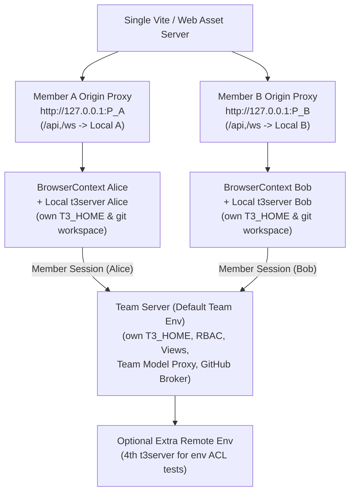

# Multi-Member E2E Testing Strategy

This document specifies how to run true end-to-end tests for T3 Code Teams with **one shared Team Server** and **at least two isolated team members** running through **separate local apps**.

It extends upstream's scenario model ([15_testing.md](../internals/15_testing.md#scenarios)) without modifying upstream scenario files so merges from `upstream/main` remain conflict-free.

---

## 1. Why upstream scenarios alone are not enough

Upstream's [`scripts/e2e.config.ts`](../../scripts/e2e.config.ts) launches a single local app (one `t3server` + one Vite server) and one browser context. Even multi-server scenarios like [`scripts/scenarios/linked-thread-connects-before-fallback-timeout.e2e.ts`](../../scripts/scenarios/linked-thread-connects-before-fallback-timeout.e2e.ts) only test one human user talking to two environments.

Team features require verifying **real multi-user interactions** across distinct origins, credentials, local environments, and live WebSocket subscriptions:

- Member A creates a thread → Member B does **not** see it by default, sees it after toggling colleagues' threads, and receives **zero** notifications unless following.
- Member A starts a thread on their **local environment** for a team project → tool calls run locally on Member A's machine, while the thread syncs into the Team Server's thread list and uses the Team Model Proxy.
- Role / View / Lock changes propagate live to other connected browsers and are enforced on both RPC and UI layers.
- Turn 1 by Alice and Turn 2 by Bob on the **same thread** on the shared server use strictly separated GitHub PATs and git commit identities, and Bob cannot steer Alice's active turn.

---

## 2. Test Topology (`TeamTopology`)



### Key design choices

1. **Isolated directory & config (zero upstream conflict):**
   - Harness & scenarios live under `scripts/scenarios/team/` with a dedicated config `scripts/e2e.team.config.ts` and script `vp run scenarios:team`.
   - CI job `test_teams_e2e` in [`.github/workflows/teams-ci.yml`](../../.github/workflows/teams-ci.yml) activates automatically once `scripts/e2e.team.config.ts` exists.
2. **One Vite server + one lightweight reverse proxy per member:**
   - Each member gets their own loopback origin (`http://127.0.0.1:<portA>`, `http://127.0.0.1:<portB>`) and their own Playwright `BrowserContext`.
   - Cookies, `localStorage`, IndexedDB, DPoP keys, CORS, and WebSocket sessions are 100% isolated per member without paying the RAM/startup overhead of multiple Vite servers.
   - Each member runs a real, separate local `t3server` with its own `T3_HOME` under `.t3/scenarios-team/<run>/member-<pseudo>/` and its own local git workspace.
3. **Deterministic `Replay (dev)` agent:**
   - Reuses upstream's `devReplay` provider (`multi-turn`, `approval`, `question`, `showcase`) so scenarios are fast, free, and completely offline.
   - Never uses `sleep` or fixed delays; asserts via `expect.poll`, `waitFor`, and server events per [15_testing.md](../internals/15_testing.md#waiting-for-work).

---

## 3. Harness API & Test Doubles

### Declarative provisioning

```ts
await using topology = await startTeamTopology({
  members: [
    { pseudo: "alice", role: "owner" },
    { pseudo: "bob", role: "regular" },
    { pseudo: "charlie", role: "modo" }, // optional
  ],
  extraRemoteEnvironments: 1, // optional (Milestone 5)
  fakeTeamLlm: true, // optional (Milestone 6)
  fakeGitHub: true, // optional (Milestone 7)
});
```

Cleanup is guaranteed by `AsyncDisposableStack` (`await using`), tearing down all browser contexts, proxies, `t3server` child processes, and temporary `T3_HOME` directories even on failure.

### Specialized test hooks

1. **Browser `Notification` recorder (Milestone 2):**
   - Each member's `BrowserContext` injects a small `addInitScript` shim wrapping `window.Notification` to record every triggered notification (`member.notifications()`).
   - Enables exact assertions: `expect(await bob.notifications()).toEqual([])` before following, and exact title/body assertions after clicking **Follow**.
2. **Fake Team LLM server (Milestone 6):**
   - A local HTTP mock endpoint (OpenAI/Anthropic compatible) registered **only** on the Team Server with a secret key (`TEAM_SECRET_KEY`).
   - Proves that when Bob starts a thread on his **local environment** for a team project, inference requests arrive via the Team Model Proxy bearing `TEAM_SECRET_KEY`, while Bob's local `T3_HOME` never stores `TEAM_SECRET_KEY`.
3. **Fake Git HTTP & GitHub API server (Milestone 7):**
   - Serves a local bare git repository over HTTP (`http://127.0.0.1:<port>/org/repo.git`) and records the exact `Authorization` header on every `git push` and GitHub API call.
   - Verifies end-to-end:
     - Alice's Turn 1 commits as `Alice <alice@test>` and authenticates with `PAT_ALICE`.
     - Bob's Turn 2 on the **same thread** recycles the warm session, commits as `Bob <bob@test>`, and authenticates with `PAT_BOB` (never `PAT_ALICE`).
     - While Alice's turn is paused in `approval` / `question`, Bob's message queues in dashed style with no `Send now` and no `Interrupt`; if an `admin` clicks **`Interrupt`**, Alice's active turn credential lease is revoked immediately.

---

## 4. Scenario Matrix by Milestone

| Milestone | Scenario file (`scripts/scenarios/team/`)     | What it proves across 2+ live apps                                                                                                                                                                                                                                                                                                                                                                                                                                                                                                                                                                                                                                                          |
| --------- | --------------------------------------------- | ------------------------------------------------------------------------------------------------------------------------------------------------------------------------------------------------------------------------------------------------------------------------------------------------------------------------------------------------------------------------------------------------------------------------------------------------------------------------------------------------------------------------------------------------------------------------------------------------------------------------------------------------------------------------------------------- |
| **M1**    | `join-and-pseudo-filtering.e2e.ts`            | Deep-link invite with prefilled pseudo, `alice: <title>` prefix, default "My threads" filter hiding Alice's thread from Bob, live reveal via colleagues toggle.                                                                                                                                                                                                                                                                                                                                                                                                                                                                                                                             |
| **M2**    | `notifications-and-follow.e2e.ts`             | Zero notifications for Bob on Alice's turns; Bob clicks **Follow** → receives notifications on Alice's next turn; **Unfollow** silences again; Alice and Bob both follow Charlie's thread → Alice snoozes Charlie's thread (or a notification from it) → Alice's thread is snoozed and silenced while Bob still sees Charlie's thread unsnoozed and receives Charlie's next notification; Alice unsnoozes (or unfollows) cleanly without affecting Bob or Charlie.                                                                                                                                                                                                                          |
| **M3**    | `views-rbac-and-locking.e2e.ts`               | `admin` creates restricted View; `modo` moves thread into it → disappears live from `regular` Bob's browser and direct RPC returns `403`; read-only View blocks posting; locked thread blocks even creator (`regular`).                                                                                                                                                                                                                                                                                                                                                                                                                                                                     |
| **M4**    | `mcp-containment-and-queue-controls.e2e.ts`   | Agent triggered by `regular` Bob obeys Bob's RBAC/View/Lock permissions via member-bound MCP (`actingMemberId`, inherited by delegates); `--team-hub-only` `t3hub` rejects direct agent execution while serving loopback `t3runner`; while Alice's turn is running, Bob's message enters the native dashed queue (`QueuedRunsControl`) with no `Send now` and no `Interrupt`; only Alice (creator) sees `Send now`; `admin` sees explicit `Interrupt` (no `Send now`); switching authors recycles the warm session and rotates the MCP token.                                                                                                                                               |
| **M5**    | `local-sync-envs-and-notes.e2e.ts`            | Bob starts a thread on his **local environment** for a team project → tool calls run on Bob's local workspace while the thread syncs into Alice's (`owner`) team thread list; Alice cannot execute on Bob's laptop and sees the inaccessible-environment banner (`Fork this thread` / `Leave a note`); Alice (`owner`) & a `regular` colleague leave notes → Bob sees extra confirmation for `regular` author vs. 1-click for `owner`, edits/accepts a note, sends an **empty prompt**, and a concurrently arriving note is ignored by that turn and re-anchored after it; note approved mid-turn enters the dashed queue; restricted remote env is hidden/blocked for Bob (RPC & MCP).     |
| **M6**    | `team-providers-skills-and-preprompts.e2e.ts` | Bob starts a local thread on a team project with zero local provider setup → inference routes through Team Model Proxy / ephemeral `token-lease` (zero `refresh_token` in Bob's local `T3_HOME`, personal subscription isolated); revoking Bob returns `403` and purges his local token; pure-Markdown team skill + `"thread"` and `"turn"` pre-prompts defined by `owner`/`modo` auto-sync into Bob's isolated `team:<id>:*` profile without modifying personal `~/.gemini`, keeping personal skills accessible with team precedence on slug collision.                                                                                                                                    |
| **M7**    | `github-per-turn-forwarding.e2e.ts`           | Alice Turn 1 pushes with `PAT_ALICE` + Alice git author; Bob Turn 2 on the same thread recycles the warm session and pushes with `PAT_BOB` + Bob git author; `admin` clicking `Interrupt` (or creator steering a foreign-authored turn via `Send now`) immediately revokes the active turn's GitHub credential lease.                                                                                                                                                                                                                                                                                                                                                                       |
| **M8**    | `team-scheduled-tasks.e2e.ts`                 | Personal env hides virtual `"personal"` team in Scheduled Tasks UI; `modo` creates and runs a `minimal` team scheduled task on `(team, env)` → creates a team-owned thread (`scheduled: <title>`, hidden by default until toggle/follow, zero default notifications); `regular` sees task read-only; `modo` can post in the unlocked team-owned thread (queued dashed mid-turn with no `Send now`), cannot create/edit an `owner`-configured `elevated` task; `minimal` `team-automation` MCP cannot read `admin`-only Views; scheduled task runs cleanly without a GitHub account configured and uses the dedicated team automation GitHub account when configured (never a member's PAT). |
| **M9**    | `upstream-mobile-compatibility.e2e.ts`        | Standard pairing QR/code generated by Bob binds a non-team-aware mobile client session (no fork header) to Bob's `memberId`; `subscribeShell`/`subscribeThread`/`searchThreads` dynamically prefix team titles (`alice: <title>`, `scheduled: <title>`) without mutating SQLite, and renaming from the mobile client strips any leading prefix; per-member snooze overlays apply per session without leaking across teammates; Bob's mobile client shows only owned + followed threads by default until Bob switches his Desktop/Web preference to all accessible threads; RBAC, Views, thread locks, and filtered notifications remain strictly enforced server-side.                      |
