# Skill map

Generated by `vp run workflow:map` from every `workflow/skills/*/*/**.md`. Do not edit by hand.
An arrow means the first skill's files name the second, so it may hand work to it or tell the agent to read it.

- **Entry points** (call others, nothing calls them): ak-help, figure-it-out, full-stop, grill-me, ketchup-video (user-only), reflect, teach
- **Hubs** (call others and are called): architect, arena, automate-me, babysit-pr, bcheck, benchmark-checklist, blast-radius, caveman (user-only), codebase-design, comment-sicko, correct (user-only), council, create-verification-skill, diagnosing-bugs, diff-review, domain-modeling, explain-work, file-pr, full-send, grill-with-docs, grilling, handoff, how, implement, implement-spec, improve-codebase-architecture, interrogate, ketchup, leaving-pr-comments, linus (user-only), maestro, maestro-worker, maintain-verification-skill, modernize, no-comments, plan-to-issues (user-only), principle-attack-the-premise (user-only), principle-build-the-lever (user-only), principle-explain-the-number (user-only), principle-fix-root-causes, principle-minimize-reader-load (user-only), principle-prove-it-works, principle-type-system-discipline (user-only), recall, replan, retro, second-opinion, setup-matt-pocock-skills, show-me-your-work, swarm, takeover, tdd, technical-writing, to-spec, to-tickets, triage, triage-issues, typescript-best-practices, validate-change, verify, wayfinder, why, writing-for-agents
- **Leaves** (called, call nothing): bro, frontend-design, in-your-own-words, principle-boundary-discipline (user-only), principle-encode-lessons-in-structure (user-only), principle-experience-first (user-only), principle-foundational-thinking (user-only), principle-guard-the-context-window (user-only), principle-laziness-protocol, principle-make-operations-idempotent (user-only), principle-model-the-domain (user-only), principle-outcome-oriented-execution (user-only), principle-redesign-from-first-principles (user-only), principle-separate-before-serializing-shared-state (user-only), principle-sequence-verifiable-units (user-only), principle-test-behavior-not-implementation, prototype, research, sol-loop, statechart (user-only), to-questionnaire, unslop, wizard
- **Standalone** (no links either way): sharpen, t3code-update

```mermaid
flowchart LR
  subgraph ak
    ak_help["ak-help"]
    bcheck["bcheck"]
    caveman["caveman (user-only)"]
    comment_sicko["comment-sicko"]
    linus["linus (user-only)"]
    maestro["maestro"]
    maestro_worker["maestro-worker"]
    plan_to_issues["plan-to-issues (user-only)"]
    replan["replan"]
    second_opinion["second-opinion"]
    triage["triage"]
    validate_change["validate-change"]
    verify["verify"]
  end
  subgraph anthropic
    frontend_design["frontend-design"]
  end
  subgraph mattpocock
    codebase_design["codebase-design"]
    diagnosing_bugs["diagnosing-bugs"]
    diff_review["diff-review"]
    domain_modeling["domain-modeling"]
    grill_me["grill-me"]
    grill_with_docs["grill-with-docs"]
    grilling["grilling"]
    handoff["handoff"]
    implement["implement"]
    implement_spec["implement-spec"]
    improve_codebase_architecture["improve-codebase-architecture"]
    prototype["prototype"]
    research["research"]
    retro["retro"]
    setup_matt_pocock_skills["setup-matt-pocock-skills"]
    tdd["tdd"]
    teach["teach"]
    to_questionnaire["to-questionnaire"]
    to_spec["to-spec"]
    to_tickets["to-tickets"]
    triage_issues["triage-issues"]
    wayfinder["wayfinder"]
    wizard["wizard"]
    writing_for_agents["writing-for-agents"]
  end
  subgraph pstack
    architect["architect"]
    arena["arena"]
    automate_me["automate-me"]
    benchmark_checklist["benchmark-checklist"]
    blast_radius["blast-radius"]
    bro["bro"]
    correct["correct (user-only)"]
    create_verification_skill["create-verification-skill"]
    explain_work["explain-work"]
    figure_it_out["figure-it-out"]
    how["how"]
    in_your_own_words["in-your-own-words"]
    interrogate["interrogate"]
    ketchup["ketchup"]
    ketchup_video["ketchup-video (user-only)"]
    maintain_verification_skill["maintain-verification-skill"]
    no_comments["no-comments"]
    recall["recall"]
    reflect["reflect"]
    show_me_your_work["show-me-your-work"]
    statechart["statechart (user-only)"]
    swarm["swarm"]
    technical_writing["technical-writing"]
    typescript_best_practices["typescript-best-practices"]
    unslop["unslop"]
    why["why"]
    principles["principle-* (see lists above)"]
  end
  subgraph tstack
    babysit_pr["babysit-pr"]
    council["council"]
    file_pr["file-pr"]
    full_send["full-send"]
    full_stop["full-stop"]
    leaving_pr_comments["leaving-pr-comments"]
    modernize["modernize"]
    sol_loop["sol-loop"]
    takeover["takeover"]
  end
  ak_help --> automate_me
  ak_help --> bcheck
  ak_help --> full_send
  ak_help --> implement_spec
  ak_help --> maestro
  ak_help --> maestro_worker
  ak_help --> plan_to_issues
  ak_help --> replan
  ak_help --> to_spec
  ak_help --> to_tickets
  ak_help --> wayfinder
  ak_help --> writing_for_agents
  architect --> codebase_design
  architect --> interrogate
  architect --> principles
  arena --> principles
  automate_me --> caveman
  automate_me --> recall
  automate_me --> unslop
  automate_me --> writing_for_agents
  babysit_pr --> leaving_pr_comments
  bcheck --> diagnosing_bugs
  bcheck --> full_send
  bcheck --> grilling
  bcheck --> how
  bcheck --> maestro
  bcheck --> replan
  bcheck --> tdd
  bcheck --> to_tickets
  benchmark_checklist --> principles
  blast_radius --> how
  blast_radius --> interrogate
  blast_radius --> unslop
  caveman --> bro
  caveman --> explain_work
  caveman --> ketchup
  codebase_design --> principles
  comment_sicko --> no_comments
  correct --> principles
  council --> second_opinion
  create_verification_skill --> maintain_verification_skill
  diagnosing_bugs --> benchmark_checklist
  diagnosing_bugs --> improve_codebase_architecture
  diagnosing_bugs --> principles
  diagnosing_bugs --> why
  diff_review --> principles
  diff_review --> setup_matt_pocock_skills
  diff_review --> typescript_best_practices
  diff_review --> validate_change
  domain_modeling --> why
  explain_work --> how
  explain_work --> unslop
  explain_work --> why
  figure_it_out --> architect
  figure_it_out --> arena
  figure_it_out --> full_send
  figure_it_out --> maestro
  figure_it_out --> principles
  figure_it_out --> show_me_your_work
  figure_it_out --> swarm
  figure_it_out --> to_tickets
  figure_it_out --> validate_change
  figure_it_out --> wayfinder
  file_pr --> babysit_pr
  file_pr --> leaving_pr_comments
  file_pr --> technical_writing
  full_send --> babysit_pr
  full_send --> benchmark_checklist
  full_send --> diagnosing_bugs
  full_send --> file_pr
  full_send --> frontend_design
  full_send --> show_me_your_work
  full_send --> sol_loop
  full_send --> tdd
  full_send --> validate_change
  full_send --> verify
  full_stop --> full_send
  grill_me --> grilling
  grill_with_docs --> domain_modeling
  grill_with_docs --> grilling
  grilling --> domain_modeling
  grilling --> prototype
  grilling --> research
  grilling --> to_questionnaire
  grilling --> to_spec
  grilling --> wayfinder
  handoff --> show_me_your_work
  how --> explain_work
  implement --> principles
  implement --> tdd
  implement --> validate_change
  implement --> verify
  implement_spec --> implement
  implement_spec --> setup_matt_pocock_skills
  implement_spec --> validate_change
  improve_codebase_architecture --> codebase_design
  improve_codebase_architecture --> domain_modeling
  improve_codebase_architecture --> grilling
  interrogate --> arena
  interrogate --> in_your_own_words
  ketchup --> bro
  ketchup_video --> ketchup
  leaving_pr_comments --> unslop
  linus --> diff_review
  linus --> triage
  maestro --> domain_modeling
  maestro --> grilling
  maestro --> ketchup
  maestro --> maestro_worker
  maestro --> plan_to_issues
  maestro --> replan
  maestro --> research
  maestro --> retro
  maestro --> statechart
  maestro --> to_questionnaire
  maestro --> to_spec
  maestro --> to_tickets
  maestro --> triage_issues
  maestro --> wayfinder
  maestro --> wizard
  maestro_worker --> babysit_pr
  maestro_worker --> bcheck
  maestro_worker --> file_pr
  maestro_worker --> full_send
  maestro_worker --> leaving_pr_comments
  maestro_worker --> sol_loop
  maestro_worker --> validate_change
  maintain_verification_skill --> create_verification_skill
  modernize --> leaving_pr_comments
  modernize --> validate_change
  no_comments --> architect
  no_comments --> comment_sicko
  no_comments --> principles
  no_comments --> why
  plan_to_issues --> bcheck
  plan_to_issues --> maestro
  plan_to_issues --> replan
  plan_to_issues --> setup_matt_pocock_skills
  plan_to_issues --> to_tickets
  principles --> why
  principles --> benchmark_checklist
  principles --> codebase_design
  principles --> show_me_your_work
  principles --> typescript_best_practices
  recall --> automate_me
  recall --> handoff
  recall --> ketchup
  recall --> takeover
  recall --> unslop
  reflect --> principles
  reflect --> recall
  reflect --> writing_for_agents
  replan --> plan_to_issues
  replan --> verify
  retro --> correct
  retro --> principles
  retro --> writing_for_agents
  second_opinion --> council
  second_opinion --> sol_loop
  setup_matt_pocock_skills --> domain_modeling
  setup_matt_pocock_skills --> grill_with_docs
  setup_matt_pocock_skills --> grilling
  setup_matt_pocock_skills --> improve_codebase_architecture
  setup_matt_pocock_skills --> prototype
  setup_matt_pocock_skills --> research
  setup_matt_pocock_skills --> to_spec
  setup_matt_pocock_skills --> to_tickets
  setup_matt_pocock_skills --> triage_issues
  setup_matt_pocock_skills --> wayfinder
  show_me_your_work --> principles
  show_me_your_work --> recall
  show_me_your_work --> second_opinion
  show_me_your_work --> unslop
  swarm --> arena
  swarm --> implement_spec
  swarm --> maestro
  swarm --> principles
  swarm --> to_tickets
  takeover --> babysit_pr
  takeover --> file_pr
  takeover --> leaving_pr_comments
  takeover --> modernize
  takeover --> validate_change
  tdd --> codebase_design
  tdd --> principles
  tdd --> validate_change
  teach --> research
  technical_writing --> unslop
  to_spec --> grilling
  to_spec --> principles
  to_spec --> replan
  to_spec --> setup_matt_pocock_skills
  to_spec --> to_tickets
  to_tickets --> codebase_design
  to_tickets --> implement_spec
  to_tickets --> maestro
  to_tickets --> replan
  to_tickets --> setup_matt_pocock_skills
  to_tickets --> to_spec
  to_tickets --> wizard
  triage --> diff_review
  triage --> interrogate
  triage --> linus
  triage --> triage_issues
  triage --> verify
  triage_issues --> bcheck
  triage_issues --> grilling
  triage_issues --> how
  triage_issues --> maestro
  triage_issues --> setup_matt_pocock_skills
  triage_issues --> triage
  triage_issues --> why
  typescript_best_practices --> principles
  validate_change --> blast_radius
  validate_change --> codebase_design
  validate_change --> diff_review
  validate_change --> no_comments
  validate_change --> principles
  validate_change --> replan
  validate_change --> technical_writing
  validate_change --> writing_for_agents
  verify --> create_verification_skill
  verify --> maintain_verification_skill
  verify --> validate_change
  wayfinder --> grilling
  wayfinder --> improve_codebase_architecture
  wayfinder --> maestro
  wayfinder --> prototype
  wayfinder --> research
  wayfinder --> setup_matt_pocock_skills
  wayfinder --> to_spec
  wayfinder --> to_tickets
  wayfinder --> wizard
  why --> explain_work
  writing_for_agents --> unslop
```

